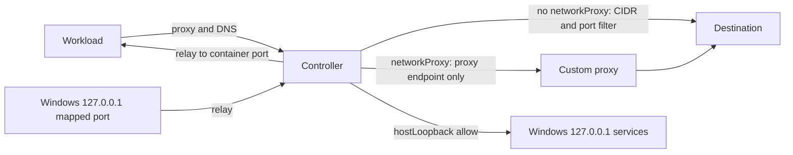

# Feature design: WSLC built-in egress proxy

> **Audience:** MXC developers

- **Status:** Proposed
- **Issue:** [#1462](https://github.com/microsoft/mxc/issues/1462)
- **Contributor:** `@theelliotm`
- **Implementation PRs:** Not started.

WSLC networking today supports only all-allow (`BRIDGED`) or all-deny (`NONE`).
This design adds a per-container controller container that enforces TCP CIDR
and port rules, and lets `egress`, `ingress` and `hostLoopback` defaults be set
independently. It uses the existing network fields; see [`api.md`](api.md) for
SDK usage.

Built on the WSLC SDK networking support from Pierre and the WSLC team
(microsoft/WSL#42002) and host loopback support from
[@beena352](https://github.com/beena352) (microsoft/WSL#42087).

## Problem and scope

- **Problem:** WSLC callers can't grant partial network access. These are rejected today
  (`wslc/common/policy.rs`):
  - Egress allow/deny rules ("networking is all-or-nothing").
  - Mixed `egress`/`ingress`/`hostLoopback` defaults.
  - Port mappings without bridged networking.
  - `runtimeConfig.networkProxy` with isolated networking.

- With this feature, configs with CIDR rules, mixed defaults, egress deny plus `networkProxy`, or
  all-deny plus port mappings automatically use a built-in controller. __Configs
  that are valid today don't change.__

- **Example 1: CIDR allow-list.** A create-and-run workload may reach only
  `10.0.0.0/8` on TCP 443:

  ```json
  "network": {
    "egress": {
      "default": "deny",
      "allow": [{ "to": [{ "cidr": "10.0.0.0/8" }], "ports": [{ "protocol": "tcp", "port": 443 }] }]
    },
    "ingress": { "default": "deny", "hostLoopback": "deny" }
  }
  ```

  `curl https://10.1.2.3` succeeds. `curl https://1.1.1.1`, and any connection
  that bypasses the proxy variables, fails. The run deletes the controller and
  networks on exit.

- **Example 2: Windows loopback service plus an inbound port.** All egress
  denied, `hostLoopback: allow`, and `wslc.portMappings`
  `[{ "windowsPort": 18080, "containerPort": 8080, "protocol": "tcp" }]`.
  The workload reaches a Windows service on `127.0.0.1:5432` as
  `host.wslc.internal:5432`; Windows reaches the workload's server at
  `127.0.0.1:18080`. Everything else is denied.

- **Non-goals:**
  - Hostname filtering.
  - UDP (other than DNS) and ICMP egress in proxied mode.
  - UDP port mappings; the SDK still returns `E_NOTIMPL`.
  - Inbound `hostLoopback`; see [hostLoopback](#hostloopback).
  - Non-loopback `windowsAddress` on port mappings.
  - Changing `NONE` or `BRIDGED` behavior, other than the
    [host loopback behavior change](#enabling-host-loopback-in-wsl).

## Proposed behavior

### When the proxy is used

| Config | Network mode | Port mappings |
|---|---|---|
| Everything denied, no port mappings | `NONE` (unchanged) | n/a |
| Everything allowed, with or without the cooperative proxy | `BRIDGED` (unchanged) | On the workload, direct (unchanged) |
| Everything denied, with port mappings | Proxied (new) | On the controller, relayed to the workload |
| Mixed `egress`/`ingress`/`hostLoopback` defaults, egress CIDR rules, or egress deny plus `networkProxy` | Proxied (new) | On the controller, relayed to the workload |

- Configs that are valid today never use the proxy, and their port mappings
  behave as they do today.

- Proxied mode requires WSL 3.0.5 or later. `NONE` and `BRIDGED` keep
  today's minimum WSL version.

- Everything-denied configs with port mappings, rejected today, use proxied
  mode: a port mapping is its own grant, so the controller relays it while all
  other traffic stays denied.

- **NOTE:** Moving a config from `BRIDGED` to proxied mode immediately blocks its UDP
  (other than DNS) and ICMP traffic, even with `egress.default: allow`. __Document this.__

- Omitted fields keep their current WSLC defaults.

- Changed operations: create-and-run, provision, start, stop and deprovision.
  Exec, discovery and validation are unchanged apart from the newly accepted
  values.

### Egress filtering

- The controller runs an HTTP CONNECT/HTTP proxy and a DNS forwarder.

- It checks the resolved destination IP and port against the egress default
  and the allow/deny rules. Deny wins.

- Allow rules must be TCP. Allow rules for `udp`, `icmp` or `any` are rejected
  because the controller can't carry that traffic. Deny rules for any protocol
  are accepted, since nothing but TCP and DNS leaves the workload. Deny rules 
  for `udp` or `icmp` should warn that they effectively do nothing, currently.

- `egress.default: allow` permits all TCP. UDP (other than DNS) and ICMP stay
  blocked, unlike bridged mode.

- Programs that don't use a proxy fail closed: the workload has no other route.

- The DNS forwarder runs only when `egress.default` is `allow`, an allow rule
  exists or `networkProxy` is set. Otherwise the controller refuses DNS, since
  query names can carry data out even when every destination is denied.

### hostLoopback

`hostLoopback` covers connections made outbound from the container to the
Windows host's loopback (`127.0.0.1`), not the container's own loopback.

- **Outbound:** the container connects to a service bound to Windows
  `127.0.0.1` through `host.wslc.internal`. MXC sets that name on every
    session on WSL 3.0.5 or later; see
  [Enabling host loopback in WSL](#enabling-host-loopback-in-wsl).

- **Inbound:** WSLC has no inbound path from Windows other than declared port
  mappings. A port mapping is its own grant for one port, allowed independent
  of `hostLoopback`, like the `networkProxy` endpoint.

- **Granularity:** all ports or none, as on every other backend. Egress rules
  don't apply to host loopback: `127.0.0.1` in an egress rule is the
  container's own loopback, and rules don't accept hostnames.

- **Partial support:** on WSLC, `hostLoopback` acts as an egress control
  rather than an ingress one. `allow` opens outbound to every Windows loopback
  port; inbound stays limited to declared port mappings, since WSLC can't
  forward ports it doesn't know in advance. `BRIDGED` mode already behaves
  this way. Bubblewrap instead rejects `allow` because it can honor only one
  direction. __Document this in the WSLC guides.__

- **Only the controller reaches host loopback.** The workload has no route to
  any host address. With `allow`, the controller relays `host.wslc.internal`
  traffic; with `deny`, it refuses that name and the address it resolves to.
  It always refuses its own loopback and the rest of `169.254.0.0/16`. Egress
  rules can't override these results.

- Non-loopback Windows addresses (LAN, Hyper-V switch) are ordinary egress,
  governed by egress rules. They don't substitute for `hostLoopback`: services
  must bind a non-loopback address, which exposes them to the LAN.

### Port mappings

This section covers proxied mode only. In `BRIDGED` mode, port mappings stay
on the workload and don't pass through a controller.

- A port published on a container that is only on an internal network accepts
  connections but delivers no data. Port mappings are therefore set on the
  controller, which relays TCP to the workload's container port.

- Port mappings are inbound only. They don't give the workload access to
  Windows loopback services.

- A declared mapping on Windows `127.0.0.1` is allowed under any
  `hostLoopback` or `ingress.default` value. Any local Windows process can
  connect to it. A non-loopback `windowsAddress` would be LAN ingress,
  governed by `ingress.default`; it stays unexposed.

- UDP mappings stay rejected; the SDK still returns `E_NOTIMPL`.

- The workload sees the controller's IP as the source address.

- The controller listens only on its normal-network address, so the workload
  can't connect to it.

- Duplicate `windowsPort` values and UDP mappings stay rejected.

### Custom proxy

No other backend combines `runtimeConfig.networkProxy` with egress rules (see
[`schema.md`](../../../../schema.md) and the Bubblewrap
[proxy rules](../../../../backends/bwrap/bubblewrap-backend.md)). Proxied mode
follows the same rule. With a custom proxy, the controller's only egress is
the proxy endpoint, and the custom proxy decides the final destinations.

- **Egress deny plus `networkProxy`:** the controller forwards TCP only to the
  proxy's IP and port. Proxy credentials stay in the workload's environment.

- **Proxy hostname:** MXC resolves it on Windows before creating the
  controller and passes the first IPv4 answer in the controller's policy. The
  controller relays only to that IP and never resolves the name. The
  workload's `HTTP(S)_PROXY` points at the controller, so it needs no DNS to
  reach the proxy. Bubblewrap also resolves the proxy on the host.

- **`networkProxy` plus egress rules:** rejected.

- **Loopback proxy URL:** the controller relays only to the proxy's port on
  Windows `127.0.0.1`, independent of `hostLoopback`. No other host-loopback
  port opens. This matches Bubblewrap, Seatbelt and ProcessContainer, and
  requires [host loopback in WSL](#enabling-host-loopback-in-wsl).

- **Bridged mode is unchanged:** a loopback proxy URL there is the container's
  own loopback.

### Rejected requests

These are rejected before the workload is created:

- Non-TCP allow rules, `networkProxy` plus egress rules, and UDP port mappings.
- A proxy hostname with no IPv4 answer on Windows.
- Proxied `hostLoopback: allow` when `AllowWSLContainerPrivileged` is `0`; the
  error names the policy.
- Any proxied config on WSL older than 3.0.5; the error names the required
  version.
- Egress CIDRs that overlap the controller's network subnets.

## Execution and container lifecycle support

- **Buffered and streaming stdio:** supported for create-and-run and for exec
  in an existing container. Networking doesn't affect stdio.

- **PTY:** not applicable; WSLC doesn't support PTY.

- **Create-and-run:** each run already gets its own session, named from
  `containerId`. The run creates the networks, controller and workload, and
  deletes everything on exit.

- **Container lifecycle operations:**
  - `provision-session` and the implicit session: enable host loopback on WSL
    3.0.5 or later, like every session MXC creates. Containers with any
    `hostLoopback` value can share a session.
  - `provision`: creates the networks, controller and workload. Network
    posture is fixed here.
  - `start`: starts the controller, then the workload.
  - `exec`: unchanged; traffic goes through the running controller.
  - `stop`: stops the workload, then the controller.
  - `deprovision`: deletes the workload, then the controller, then the
    networks.

- `lifecycle.destroyOnExit: false` stays unsupported.

## Backend applicability and availability

| Backend | Planned support | Required host features and how they are checked | What the probe/availability API reports |
| --- | --- | --- | --- |
| WSLC | Yes | WSL 3.0.5+ for in-SDK networking and host loopback (`WSLC_E_RUNTIME_UPDATE_NEEDED`); capability additions allowed for proxied `hostLoopback: allow` (`WSLC_E_CAPABILITY_ADDITIONS_DISABLED`) | Unchanged: WSLC available or unavailable. No per-feature capability; see [`api.md`](api.md#open-questions) |

- WSLC can be available but unable to run proxied mode on WSL older than
  3.0.5, or proxied host loopback under the admin policy. This is detected
  when the session or controller is created, before the workload exists, and
  fails closed.

- Unenforceable policy is rejected as listed in
  [Rejected requests](#rejected-requests).

## Contracts, APIs, and compatibility

- **Request fields:** no new fields for create-and-run. WSLC accepts values it
  rejects today. Accepting `networkProxy` at provision may need a contract
  change; see [Open questions](#open-questions).

- **Public APIs:** no signature changes. See [`api.md`](api.md).

- **Runtime behavior:** changes.
  - Previously rejected configs are accepted.
  - On WSL 3.0.5 or later, where MXC enables session host loopback, existing
    all-allow `BRIDGED` configs gain outbound access to Windows loopback
    services. This will happen
    regardless when updating the WSL SDK in the future. 
  - Moving a config to proxied mode blocks UDP (other than DNS) and ICMP.
  - No contract version change. Requests that are valid today behave the
    same, apart from the host loopback change above.

## Design and security

### Layout per container

- **Workload:** alone on its own internal network with the controller.
  `HTTP(S)_PROXY` and `resolv.conf` point at the controller.

- **Controller:** on the workload's internal network and on its own normal
  network for outbound traffic.

- **Controller policy:** the image is static and has no policy built in.
  MXC renders the validated policy (CIDR and port rules, `hostLoopback`, port
  mappings and the proxy endpoint) as JSON in an environment variable on the
  controller's init process, set at creation. The policy is fixed for the
  container's lifetime, so it never changes while the controller runs.



There is one controller per container, rather than one shared proxy, because:

- The WSLC SDK has no API to attach a network to a running container. Networks
  and port mappings are set only at container creation. Revisit this as WSLC
  adds APIs.

- Identifying traffic is trivial: one controller serves one container. This
  also covers containers managed through lifecycle operations.

### Relaying host loopback

With `hostLoopback: allow`, MXC builds the controller with host loopback
relaying. Otherwise none of it is set up.

- **Name lookup:** the controller's DNS answers `host.wslc.internal` with the
  controller's address on the workload's network. With `deny`, it refuses the
  name, even when DNS allows all names. MXC doesn't edit the workload's
  `/etc/hosts`.

- **Relaying:** an nftables `redirect` in the controller's own network
  namespace sends TCP to that address, on any port except DNS and the proxy
  port, to a local relay. The relay reads the original port
  (`SO_ORIGINAL_DST`) and connects to the same port on `host.wslc.internal`.
  Programs that ignore the proxy variables work too. Proxy requests for
  `host.wslc.internal` go to the same place. Nothing is forwarded or routed.

- **Capability:** the redirect needs `NET_ADMIN` in the controller, added
  through `ContainerSettings.CapabilityAdditions`. The workload never gets it.
  Capability additions are allowed unless the admin policy
  `AllowWSLContainerPrivileged` (`HKLM\Software\Policies\WSL`) is `0`. Then
  creating the controller fails with `WSLC_E_CAPABILITY_ADDITIONS_DISABLED`
  before the workload exists, and MXC returns an error naming the policy. No
  elevation is needed.

### Enabling host loopback in WSL

microsoft/WSL#42087 adds an optional session hostname for host loopback:
`WslcSetSessionSettingsHostLoopback` (C) and `SessionSettings.HostLoopback`
(C#).

- Disabled by default; a null or empty hostname keeps it disabled.

- Requires WSL 3.0.5 or later. Older runtimes fail session creation with
  `WSLC_E_RUNTIME_UPDATE_NEEDED`, so MXC sets it only on 3.0.5 or later. On
  older runtimes, `NONE` and `BRIDGED` sessions run as today without it, and
  proxied configs fail closed.

- The setting is session-wide: it opens every Windows loopback port to
  containers in the session that can route to it.

- MXC sets the hostname to `host.wslc.internal` on every session it creates,
  for create-and-run and the daemon alike. This grants no container more than
  its policy, because each controller enforces its own workload's
  `hostLoopback`:
  - `BRIDGED` containers can route to it, and their policy is already
    `hostLoopback: allow`.
  - Proxied workloads have no route; their controller relays or refuses
    host loopback traffic according to their policy.
  - `NONE` containers have no network.

- **Behavior change:** on WSL 3.0.5 or later, existing all-allow configs gain
  outbound access to Windows loopback services.

### Prototype results

A C# and Python prototype on WSL `main` (including microsoft/WSL#42002), then
on WSL 3.0.5, shows this layout enforces egress without VM root access or
added capabilities on the workload. Measurements used a session with host
loopback enabled and a server bound only to Windows `127.0.0.1:8097`. Workload
probes used direct TCP connections, ignoring the proxy variables.

| Target | Controller (normal network) | Workload, `deny` | Workload, `allow` |
|---|---|---|---|
| `host.wslc.internal` | Reached | Name refused | Reached through the controller |
| `169.254.73.249` (VM loopback relay gateway) | Not probed | Network unreachable | Network unreachable |
| Docker bridge gateway (the VM) | Not probed | Host unreachable | Not probed |
| Controller address, any port | n/a | Connection refused | Reached Windows loopback on that port |
| Windows non-loopback IP | Connection refused | Network unreachable | Network unreachable |

- The controller, on a user-created normal network, reaches Windows loopback
  through WSL's relay (`169.254.73.254`).

- The workload has no route to the VM or Windows, even with host loopback
  enabled for the session. Its only path out is the controller.

- WSL doesn't add `host.wslc.internal` to container `/etc/hosts`, so the
  controller's DNS answer decides the name.

- The controller refused the name to a workload whose DNS policy allows all
  names.

- Publishing a port on a container whose primary network is user-created
  works. Windows `127.0.0.1` reached the workload through the controller
  relay, and the controller saw `169.254.73.254` as the source. The workload
  couldn't reach the relay, the VM or Windows.

- Port mappings also work on a workload with `hostLoopback: allow`. That
  workload reached its own mapped port through Windows loopback.

### Security

- Isolation changes. Proxied workloads have no direct routes; the controller
  is the only network path and the enforcement point.

- Only the controller gets `NET_ADMIN`, and only for `hostLoopback: allow`.

- Session host loopback is always on (WSL 3.0.5 or later). Each controller,
  not the session setting, is the per-workload `hostLoopback` gate.

- DNS is refused when nothing is allowed, so query names can't carry data out.

- **Subnet overlap:** Docker's default subnets (`172.x`) can hide CIDR rules
  for the same range. MXC sets subnets explicitly and rejects overlaps.

### Components

- `wslc/common/policy.rs`: add `EGRESS_RULES` support, classify
  None/Bridged/Proxied instead of rejecting, and add protocol and port-mapping
  checks. Replace `reject_port_mappings_without_bridged_network` with
  selecting proxied mode.

- `mxc_common/network_parser.rs`: WSLC branch for egress deny plus proxy.

- `wslc/common/policy_mapping.rs`: return the new mode from
  `map_network_policy`.

- New `wslc/common/egress_controller.rs`: controller settings and lifecycle,
  including rendering the controller policy environment variable.

- `wslc/common/container_steps.rs`: networks, environment, port mappings, the
  session host loopback hostname, the controller's `NET_ADMIN`, and deleting
  leftover controllers and networks when a session starts.

- `bin/wslc_daemon/session_manager.rs`: track the controller and networks in
  `ContainerEntry`.

- New controller binary: a static Rust (musl) `[[bin]]` target in `mxc-sdk`,
  packaged as an image and imported from a tar. No new crate.

### Alternatives

- **One shared proxy:** not possible without attaching networks to running
  containers. __This can be re-evaluated as WSLC updates in the future.__

## Resource ownership and failure recovery

- **Owners:** the WSL service owns the session VM, networks and containers.
  MXC creates and deletes them in order. The caller owns the `ContainerId` for
  lifecycle operations.

- **Create order:** networks, then controller, then workload. On failure, MXC
  deletes what it created in reverse order and returns the original error
  plus any cleanup error.

- **Delete order:** workload, then controller, then networks. Deleting a
  network fails while containers are attached.

- **Persistence:** networks and containers outlive the session. The store's
  `storage.vhdx` is mounted at `/var/lib/docker`, and every session that opens
  the store recovers its SDK-created networks and all containers
  (`RecoverExistingNetworks` and `RecoverExistingContainers` in WSL's
  `WSLCSession.cpp`).

- **Create-and-run:** the per-run session is terminated on exit.

- **Daemon:** `ContainerEntry` tracks the controller and networks, and
  `Worker::shutdown` deletes them with the workload.

- **Leftovers:** a crash leaves the controller and networks in the store.
  Controller and network names use an MXC prefix and derive from the container
  ID. A store admits one live session, so when MXC starts a session on a store
  (create-and-run or daemon), any prefixed controller or network already there
  is orphaned. MXC deletes them before creating anything, which frees their
  names and subnets.

- **Controller exits during use:** the workload loses network access. MXC
  doesn't restart the controller; the caller must deprovision.

## Acceptance criteria and validation plan

Hosts: Windows x64 with WSL 3.0.5 or later (the nightly WSLC matrix). Suites:
`tests/scripts/run_wslc_all_tests.ps1` (Network Tests) and
`tests/scripts/run_wslc_state_aware_tests.ps1`, run by
`Validation.Tests.Scheduled.yml`. See the
[validation runbook](../../../build-and-test/ci-validation-infrastructure.md).

| Scenario | Expected result | Test |
|---|---|---|
| CIDR TCP allow rule | Allowed CIDR and port reached; others denied; direct connection without the proxy fails | Extend Network Tests (replaces `wslc_network_egress_rules_rejected.json`) |
| Deny rule inside an allow range | Deny wins | Extend Network Tests (replaces `wslc_network_egress_deny_rules_rejected.json`) |
| Mixed defaults, `egress.default: allow` | TCP works; UDP (other than DNS) and ICMP blocked | Proposed config |
| Everything denied, with a port mapping | Windows `127.0.0.1:<port>` reaches the workload; workload egress and DNS refused | Proposed config |
| `hostLoopback: allow` / `deny` | Windows loopback service reached / name and controller address refused | Proposed config |
| Proxied `allow` and `deny` workloads in one daemon session | Only the `allow` workload reaches Windows loopback | Extend `run_wslc_state_aware_tests.ps1` |
| `BRIDGED` container, WSL 3.0.5 or later | Reaches a Windows loopback service through `host.wslc.internal` (not yet measured) | Proposed config |
| Egress deny plus `networkProxy` (IP, hostname and loopback URL) | Only the proxy endpoint reached; unresolvable hostname rejected | Extend `run_wslc_proxy_test.ps1` |
| Non-TCP allow rule, proxy plus rules, UDP mapping | Rejected; no container created | Proposed rejection configs |
| Lifecycle provision → start → exec → stop → deprovision (proxied) | Policy enforced on exec; no controller or networks remain afterward; re-provision succeeds | Extend `run_wslc_state_aware_tests.ps1` |
| Controller and networks left in a store (killed run or daemon) | Next session on that store deletes them; the next proxied run succeeds | Proposed test |
| Configs valid today (`wslc_network_bridged/isolated/proxy*`, `wslc_port_mapping_*`) | Unchanged results | Existing tests |

- **Not testable in CI:** WSL older than 3.0.5, since CI installs at least the
  pinned version, and `AllowWSLContainerPrivileged=0`, which is host policy.
  Unit tests cover the error mapping.

- **CI checks replaced:** the two egress-rules rejection tests become
  acceptance tests; rejection coverage moves to the new rejection configs.

- SDK tests are listed in [`api.md`](api.md#validation-and-documentation).

## Delivery and documentation

Delivery order:

1. Controller binary and image build: a Linux cross-build and signing.
   `build.bat` has neither today.
2. Backend for create-and-run: policy classification, controller, networks,
   port mappings and leftover cleanup at session start.
3. Backend for lifecycle operations: daemon tracking and cleanup.
4. Host loopback: session hostname and controller relay.
5. Docs and SDK tests; no API changes.

- **SDK pin:** MXC pins `WSLC_SDK_VERSION` to 3.0.3
  (`build/build_wslc_common.rs`), which has neither the network nor the host
  loopback APIs. 3.0.5+ is the first WSL version with both; pin it once a version with it 
  ships.
  This isn't the first step, but CI needs it to test PRs 2–4, since CI installs
  WSL from the pin.

- **Contract:** a contract change is needed only if `networkProxy` is accepted at
  provision through MXC request JSON. It goes first, in the development
  contract.

- **Docs:**
  - [`schema.md`](../../../../schema.md).
  - [WSLC getting started](../../../../backends/wslc/wsl-container-getting-started.md):
    network configuration, network proxy, port mappings, UDP/ICMP in proxied
    mode, hostLoopback partial support, the behavior change and
    prerequisites.
  - [WSLC lifecycle](../../../../backends/wslc/wslc-state-aware.md): supported
    and rejected policy fields.

- **Cost:** one extra container and two networks per container, plus startup
  time.

## Open questions

1. **Provision `networkProxy`:** network posture is fixed at provision, but
   WSLC accepts the proxy only at exec (`validate_provision_policy` rejects
   it). The MXC request JSON provision contract has no `runtimeConfig`. Rust
   and .NET typed provision requests carry it; Node's doesn't. Should
   `runtimeConfig` be added to the development provision contract, or should
   exec configure the controller? Owners: `@theelliotm` and WSLC maintainers.

2. **Host loopback on older runtimes:** Currently valid `BRIDGED` contracts running 
   on WSL 3.0.3 will NOT get host loopback while those contracts running on 3.0.5 will. 
   Is this acceptable?

3. **Controller image distribution:** a bundled tar or a registry, and how is
   it signed? Owners: build maintainers.

4. **DNS and deny rules:** a deny rule covering UDP 53 is bypassed: the
   controller's DNS lookups go through Docker's resolver (`127.0.0.11`), WSL
   and Windows, which picks the server per name. 
   Potential options:
   - Query Windows' DNS servers directly, checking each IP against the rules
     first (matches LXC). Stale after network changes; VPN DNS reachability
     from WSLC is unverified.
   - Turn DNS off when any deny rule covers UDP 53 (fail closed; over-blocks).
   - Document DNS as outside egress rules.

5. **Discovery:** see [`api.md`](api.md#open-questions).

## Review checklist

- [ ] The issue has maintainer-applied `feature-accepted`; scope and contributor are agreed.
- [ ] One or two meaningful usage examples, non-goals, defaults, and failure behavior are clear.
- [ ] Every backend is considered, with explicit capability checks and probe/availability behavior.
- [ ] Execution modes and container lifecycle support are explicit; exclusions are explained.
- [ ] Resource ownership, partial failures, failed cleanup, and subsequent container creation are addressed.
- [ ] Security, contract/API compatibility, and any breaking changes are addressed.
- [ ] A separate API proposal is linked when public APIs change.
- [ ] Acceptance criteria and the CI plan cover observable behavior.
- [ ] Delivery and documentation changes are scoped; material questions are resolved.
- [ ] Answers are concise; diagrams explain the design without repeating the text.
- [ ] Maintainers have approved the spec and its status is Accepted before merge.
