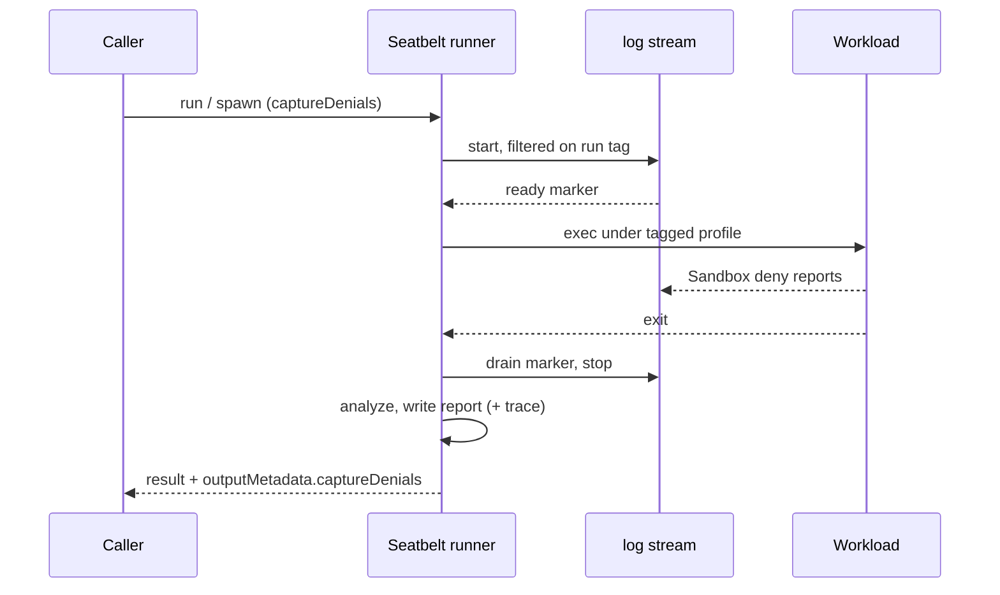

# Feature design: Seatbelt learning mode

> **Audience:** MXC developers

- **Status:** Proposed
- **Issue:** [#1591](https://github.com/microsoft/mxc/issues/1591)
- **Contributor:** `@theelliotm`
- **Implementation PRs:** [#1580](https://github.com/microsoft/mxc/pull/1580) (draft, written before this spec)
- **API proposal:** [api.md](api.md)

## Problem and scope

- macOS callers can't tell which permissions a sandboxed workload needs. When
  a Seatbelt run fails, the only evidence is the workload's own error output.
  Windows ProcessContainer already solves this with `captureDenials`.
- This adds `seatbelt.captureDenials`. MXC records the accesses the policy
  did not grant and writes a report in the
  [Windows report format](../../../../logging-access-denied.md#output-file-the-caller-consumes).

**Example 1: find why a run fails (`block`).** An agent runs `npm install`
under a policy without network or `~/.npm` write access, and it fails. The
caller reruns with `"captureDenials": {"mode": "block", "outputPath": "~/mxc/denials.json"}`.
The run fails the same way, and the report lists a file write under `~/.npm`
and `network-outbound:remote:*:443`. The caller adds `~/.npm` to
`readwritePaths`, allows outbound 443, and reruns. The caller deletes
`denials.<run-id>.json` and `denials.<run-id>.verbose.json`.

**Example 2: list everything a new tool needs in one run (`allow`).** A
developer runs `mxc-exec-mac --audit config.json`. The workload completes
because default-denied accesses are allowed. The stderr pointer gives the
report path, and the report lists everything that would have been blocked.
Explicit denies such as `deniedPaths` still apply. The developer deletes the
temp report afterward.

**Not covered:**

- Live permission prompts, policy changes during a run, or automatic policy
  generation.
- A complete record of every access. Reads of missing paths aren't reported,
  and network reports only show the port.
- Custom profiles (`profileOverride`).
- Learning mode on Linux backends.

## Proposed behavior

**Input** (`1.1.0-alpha` development contract only):

```json
"seatbelt": {
    "captureDenials": {
        "mode": "block",
        "outputPath": "~/mxc/denials.json",
        "retainEtl": false
    }
}
```

| Field | Default | Behavior |
|---|---|---|
| `mode` | `"block"` | `block`: denied accesses stay denied and are recorded. `allow`: accesses the default policy would deny are allowed and recorded. Explicit denies (`deniedPaths`, `ui` denies) stay enforced. MXC prints a warning. |
| `outputPath` | Temp file | Absolute or `~/` path. The parent directory must exist. Empty, relative, root, and directory paths are rejected. A name without an extension gets `.json`. |
| `retainEtl` | `false` | Keep the run's filtered raw log as `.seatbelt.log` next to the report, and return its path in `etlPath`. The Windows name is reused; see [compatibility](#contracts-apis-and-compatibility). |

**Result:**

- MXC adds a per-run ID to the file name. For example, `denials.json` becomes
  `denials.<pid>_<id>.json`.
- MXC writes `denials.<pid>_<id>.json` and `denials.<pid>_<id>.verbose.json`.
- `outputMetadata.captureDenials` reports `type`, `outputPath`, `exitCode`,
  `totalDenials`, `deniedResourcesTruncated`, and `etlPath` when the trace is
  retained. `mxc-exec-mac` prints the same object as one JSON line on stderr.
- `deniedResourcesTruncated: true` means the report may be missing denials.
  This happens when:
  - a collection limit is reached;
  - MXC can't confirm it received every log event; or
  - a log event can't be parsed.
- With `deniedResourcesTruncated: false`, zero denials still doesn't prove the
  policy grants everything the workload needs. See **Not covered** above.

**Output files:**

| File | Purpose | Contents |
|---|---|---|
| Report, `denials.<pid>_<id>.json` | What to change in the policy | One entry per unique denial, in the [Windows format](../../../../logging-access-denied.md#output-file-the-caller-consumes): resource, type, access, pid, and time. Full paths. |
| Verbose report, `.verbose.json` | Why the report looks the way it does | Every tagged log event, grouped by operation, process, decision, and target, with counts. Also includes events left out of the report: such as known noise from `/dev/dtracehelper` and events MXC couldn't parse. Shows completeness flags such as `processedEventsTruncated`. Paths are replaced with `<REDACTED>`. |
| Trace, `.seatbelt.log` (only with `retainEtl`) | Debugging MXC itself | The raw `log stream` lines for this run, before MXC processes them. |

MXC writes the report and verbose report together; if either write fails,
neither file is kept. Output metadata reports only the report path. The
verbose path comes from the report name.

**Collection limits:**

| Limit | Value |
|---|---|
| Line size | 64 KiB |
| Events | 100,000 |
| Bytes held in memory | 16 MiB (new) |
| Unique denials | 10,000 |
| Verbose groups | 4,096 |

After a limit is reached, MXC stops storing new events but keeps reading the
log stream. This lets the end-of-run marker arrive and lets teardown finish.

**Operations:**

| Operation | Change |
|---|---|
| Create-and-run execution | Report written before the result returns |
| Streaming (pipes and PTY) | Report written on `wait` |
| Discovery | Seatbelt reports the `captureDenials` capability |
| `mxc-exec-mac --audit` | `allow` mode with a temp report |
| Container lifecycle operations | Not applicable |
| Other backends | Unchanged |

**Rejected before the workload starts:**

- `captureDenials` together with `profileOverride`.
- `seatbelt.captureDenials` in `1.0.0`.
- `--audit` with a config that already has `captureDenials`.
- A `log stream` that isn't ready within 10 seconds, with an error that names
  the cause.

`--audit` works with any supported published-version config because it adds
capture after parsing.

**Warnings:** These go to the CLI logger and to SDK process warnings.

- The `allow`-mode enforcement warning.
- An incomplete-capture warning when MXC can't confirm it received every log
  event.
- A capture-failure warning when the run also times out, naming any retained
  trace.

## Execution and container lifecycle support

- **Create-and-run, buffered output:** supported.
- **Streaming stdio and PTY sessions:** supported. MXC finishes the report in
  `wait`. Dropping the process without `wait` stops log collection and
  writes no report.
- **Container lifecycle operations:** not applicable. Seatbelt has no
  provision, start, stop, or deprovision operations.

## Backend applicability and availability

| Backend | Planned support | Required host features and how they are checked | What the probe/availability API reports |
|---|---|---|---|
| Seatbelt | Yes | `sandbox_init` and an executable `/usr/bin/log`. Each run must also see a ready `log stream`. | `captureDenials` when both are present. |
| ProcessContainer | Already supported | Unchanged | Unchanged |
| Bubblewrap, LXC | No. Out of scope for #1591; tracked separately. | Not applicable | No capability |
| WSLC, IsolationSession, Windows Sandbox, MicroVM, Hyperlight, VM | No. Out of scope. | Not applicable | No capability |

- **Modes:** `captureDenials` means both `block` and `allow` are supported,
  on Seatbelt and ProcessContainer alike. No per-mode capability values.
- **Can Seatbelt run without capture support?** Yes, if an account or MDM
  policy blocks `log stream`. Discovery can't detect that case. The run's
  readiness check fails it before the workload starts.

## Contracts, APIs, and compatibility

- **Request fields change?** Yes, in `1.1.0-alpha` only: add
  `seatbelt.captureDenials { mode?, outputPath?, retainEtl? }`. It reuses the
  Windows field names, so both backends share one capture shape.
- **Output metadata:** no new fields. Seatbelt reports the retained
  `.seatbelt.log` path in the existing `etlPath`. Seatbelt reports capture
  failures as run errors and never sets `captureDenialsError`. When a trace is
  retained, the error names its path. If the run also times out, the SDK
  `wait` returns only the timeout, so MXC adds the capture failure and any
  trace path to the process warnings.
- **V2 changes:** `retainEtl` and `etlPath` are Windows-specific names. As
  part of #1580, the
  [SDK major-version notes](../../versioning.md#sdk-major-version-namespaces)
  will record renaming them to `retainTrace` and `tracePath` as a required V2
  change, and a tracking issue tagged for V2 will be opened. V2 should also
  move `captureDenials` to a top-level request field that each backend
  accepts or rejects, instead of a backend-specific field.
- **Public APIs change?** Yes; see [api.md](api.md).
- **Existing behavior changes?** No. Published contracts and the v1 SDKs are
  unchanged until `1.1.0` is published.

## Design and security

| Component | Change |
|---|---|
| `mxc_contract::dev` | New Seatbelt field |
| Seatbelt `profile_builder` | Adds a per-run tag to deny rules. `allow` mode uses a reporting allow baseline and keeps explicit denies. |
| Seatbelt `denial_capture` | Runs `log stream` filtered on the tag, and uses ready and drain markers. Enforces the limits above. |
| Seatbelt `capture_analysis` | Converts log events into shared report records. Uses the Windows fast path once verbose groups fill up. |
| `learning_mode_core` | Shared report writer, moved from `process_container` |
| `mxc_engine::probe` | Reports `captureDenials` for Seatbelt |
| `mxc-exec-mac` | Adds `--audit`. Prints post-wait warnings. |



- **Changes isolation?** Only in `allow` mode. Default-denied accesses are
  allowed, and explicit denies stay enforced. The workload never gets more
  access than the user who launched it. MXC prints a warning.
- **Sensitive data:** reports and traces contain paths, Mach service names,
  and ports. Seatbelt does not apply the Windows account-name redaction or
  digest rules. The docs must say so.
- **Run isolation:** each run uses a random 128-bit tag. Concurrent runs only
  read their own events.
- **Refactor or new crate?** No. Everything stays in `mxc-sdk` modules.
- **Main alternative:** running `log show` after exit. Rejected because it's
  slower, depends on log persistence, and can't confirm it saw every event.

## Resource ownership and failure recovery

- **MXC owns:**
  - the `log stream` child process;
  - the workload process group;
  - in-memory event buffers.

  `wait` and drop stop all three.
- **Caller owns:**
  - the report, verbose report, and retained trace, including temp-path ones.

  MXC never deletes them after a successful run.
- **Capture fails to start:** the workload never starts and no files are
  written.
- **Collection or write fails after exit:** the run returns an error. A
  timeout keeps its timeout result, and the capture failure goes to the
  process warnings.
- **Termination fails:** MXC removes the report pair and returns an error.
  Buffered callers only get the error, so they can't find the report.
  A retained trace is kept, and the error names it.
- **MXC killed mid-run:** the orphaned `log stream` exits when its output pipe
  closes. The workload may keep running: pipe workloads run in their own
  session, and Seatbelt has no parent-death cleanup. This is existing
  Seatbelt behavior and isn't changed here.
- **Next run:** independent. It gets a new tag and new file names.

## Acceptance criteria and validation plan

Host: the macOS hosts in the `macos` job of
`.github/workflows/Validation.Tests.Matrix.Job.yml`. Suite:
`tests/scripts/run_seatbelt_capture_denials_test.sh`, run by
`run_seatbelt_all_tests.sh` through
`scripts/ci/run_backend_validation_tests.sh seatbelt`.

| Scenario | Asserted result | Test |
|---|---|---|
| `block` file and network deny | Access fails, and the report lists both | Existing |
| `allow` default-denied access | Access succeeds and is listed | Existing |
| `allow` with `deniedPaths` | Still denied | Existing |
| `--audit` | Temp report, pointer on stderr, warning | Existing |
| GUI with and without `guiAccess`, clipboard denies | Expected records | Existing |
| Host loopback in `allow` mode | Deny, allow, and proxy-port exception honored | Existing |
| Timeout plus report-write failure | CLI error includes both causes; SDK `wait` returns `TimedOut` with the capture failure in warnings | Existing, extended |
| `profileOverride`, `1.0.0` field, `--audit` with capture | Rejected before start | Existing and new |
| Two overlapping runs, same `outputPath` | Separate reports; each excludes the other's sentinel; no collectors left | New |
| Byte budget reached before event limit | `deniedResourcesTruncated: true`, run completes | New |
| `retainEtl` | `.seatbelt.log` exists, and the pointer's `etlPath` names it | New |
| Incomplete drain | CLI prints warning | New |
| Termination failure | Error returned; no report files remain | New (unit-level; can't force on a real host) |
| `mxc-exec-mac` killed mid-run | No tagged `log stream` remains | New |
| Discovery | `seatbelt` lists `captureDenials` | New, SDK discovery check in macOS CI |

- **CI checks removed?** No.
- **Not tested:** accounts or MDM policies that block `log stream`.

## Delivery and documentation

1. This spec PR.
2. #1580, updated to match this spec: Seatbelt capture, development contract
   field, `--audit`, shared report writer, byte budget, completeness and
   warning fixes, and discovery. It also records the V2 rename and opens the
   V2 tracking issue.
3. `retainEtl` for Seatbelt, reported in `etlPath`.
4. Contract `1.1.0` publication. This is a maintainer step.
5. Typed SDK support, after `sdkMajorTargets["1"]` is `1.1.0`. See [api.md](api.md).

**Docs:**

- `docs/backends/seatbelt/seatbelt-backend.md`:
  - Covers limits, incomplete reports, and cleanup.
  - Explains that `guiAccess` grants appear only in verbose output.
  - Covers the remote-host limitation and `log stream` readiness errors.
  - Separates `--audit` version rules from JSON version rules.
- `docs/logging-access-denied.md`: Seatbelt resource format, for example
  `network-outbound:remote:*:443`, and redaction differences.
- `docs/schema.md`, `docs/containment-policy/dev/policy.md`, and the versioning
  feature list.
- `docs/development/architecture/versioning.md`: the V2 rename of `retainEtl`
  and `etlPath`.
- SDK references are listed in [api.md](api.md).

## Open questions

None.

## Review checklist

- [ ] The issue has maintainer-applied `feature-accepted`; scope and contributor are agreed.
- [ ] One or two meaningful usage examples, non-goals, defaults, and failure behavior are clear.
- [ ] Every backend is considered, with explicit capability checks and probe/availability behavior.
- [ ] Execution modes and container lifecycle support are explicit; exclusions are explained.
- [ ] Resource ownership, partial failures, failed cleanup, and subsequent container creation are addressed.
- [ ] Security, contract/API compatibility, and any breaking changes are addressed.
- [ ] A separate API proposal is linked when public APIs change.
- [ ] Acceptance criteria and the CI plan cover observable behavior.
- [ ] Delivery and documentation changes are scoped; material questions are resolved.
- [ ] Answers are concise; diagrams explain the design without repeating the text.
- [ ] Maintainers have approved the spec and its status is Accepted before merge.
