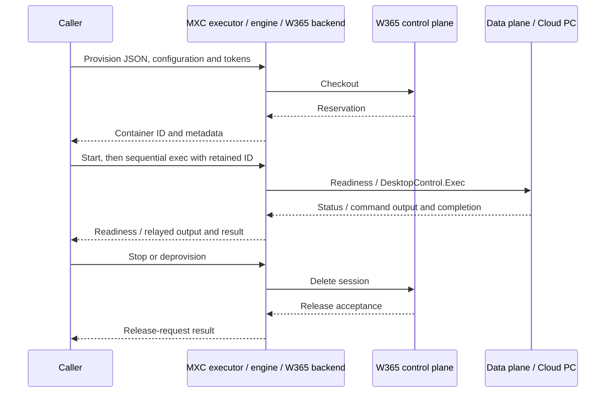

# Feature design: Windows 365 for Agents backend

> **Audience:** MXC developers

- **Status:** Proposed
- **Issue:** [#1615: Add new experimental backend for Windows 365](https://github.com/microsoft/mxc/issues/1615)
- **Contributor:** @tbyfield (proposal); W365 team (planned implementation).
- **Implementation PRs:** Not started.

The issue has `feature-accepted`; scope and contributor are agreed.
Design approval is pending.

## Problem and scope

An agent's host machine may lack access to corporate resources, required
Windows applications, or the organization's configured working environment.
[Windows 365 for Agents](https://learn.microsoft.com/en-us/windows-365/agents/introduction-windows-365-for-agents)
(W365A) provides pools of preconfigured, corporate-managed Cloud PCs where
those resources and tools can be made available. An MXC caller can use that
environment without requiring the same connectivity or software on its own
machine.

This integration will let MXC callers reserve a Cloud PC from an existing pool,
run commands using its configured corporate connectivity and installed tools,
and release it when finished. Files and other guest state persist between
commands in the same reservation, so an agent can carry out a multi-step
workflow rather than starting from a fresh environment for each command.

This design covers an initial, deliberately scoped experimental feature set:
reservation, readiness, command execution, and release, with caller-supplied
pool, identity, service coordinates, and credentials. It is not a complete
integration of all W365A capabilities. The non-goals below apply to this
milestone; any later expansion requires separate scope and design agreement.

Access to corporate resources depends on the selected Cloud PC's network
configuration, workload credentials, and permissions. MXC does not establish
that access or guarantee application SSO; W365A service credentials authorize
reservation and command execution, not access to every resource inside the guest.

The W365A control plane manages reservations. The data plane provides readiness
checks and command execution through DesktopControl.Exec, a remote
command-execution capability that must be available on the Cloud PC.

### Usage scenario

**Build an internal Windows project from an external agent host.** An agent
runs on a machine without access to the organization's internal source
repository or its Windows build tools. Here, the caller is the agent or client
application invoking MXC. It supplies a ready-to-use W365A pool GUID, approved
service coordinates, `HumanUser` identity information, and valid control-plane
and data-plane tokens. The pool's Cloud PCs are already
configured with the required corporate connectivity, repository credentials,
and build tools.

The agent or client application invokes MXC's `provision` operation; the W365A
backend requests a Cloud PC reservation from the service and returns its
container ID. The application then invokes `start`, which polls the service
until the Cloud PC is ready or reports a failure. It invokes `exec` for each
command using that same ID. MXC sends the commands to DesktopControl.Exec on
the Cloud PC to retrieve the internal project, run its Windows build, and
inspect the build results.
The source checkout and build outputs remain available between commands;
the agent host needs neither direct repository access nor the Windows toolchain.
The agent or client application collects the required results through command
output and invokes `deprovision` through MXC in final cleanup, retaining the
reservation ID if release fails.

This is the initial user workflow. Guest-state retention and recovery from a
fresh caller process are supporting lifecycle requirements, covered below,
not separate reasons to choose W365A.

### Non-goals

- Pool creation, discovery or selection, Graph permissions, remote access probes,
  capacity ranking, and fallback to another pool.
- MXC sign-in, account brokering, token acquisition or refresh, application-only
  or agentic identities, and guest application SSO guarantees.
- Create-and-run execution, returned piped/buffered process handles, PTY, a
  persistent shell, automatic command replay, or hidden keepalive/replacement.
- Local mounts, workload network/proxy/UI/clipboard enforcement on the Cloud PC,
  provisioning a new VM, RDP/screen sharing, and a new daemon or workspace crate.
- Typed SDK publication.

## Proposed behavior

The proposal adds experimental containment `w365_agents` and the
`w365Agents` phase settings.
The initial access path is MXC request JSON through a feature-enabled native
executor, not new Rust, .NET, or Node typed SDK APIs. The caller supplies
deployment coordinates and resource-specific tokens on each invocation,
including refreshed credentials for cleanup.

For each lifecycle `exec` request, MXC connects to DesktopControl.Exec on the
reserved Cloud PC and sends the requested command, working directory,
environment overrides, and timeout. DesktopControl.Exec executes the command
on that Cloud PC. MXC relays stdin, stdout, and stderr over the connection and
returns the remote command's exit code on normal completion. The command does
not run on the machine hosting MXC.

| Operation | Service interaction | Observable result |
| --- | --- | --- |
| `provision` | Reserves a Cloud PC from the caller-selected pool through the control plane. | One checkout; opaque container ID and checkout metadata on success. |
| `start` | Polls the reserved Cloud PC's readiness through the data plane. | Returns only on `Ready`, or reports an explicit failure/timeout. |
| `exec` | Invokes DesktopControl.Exec on the reserved Cloud PC to execute the requested command. | Synchronous stdin/stdout/stderr relay and remote exit code, or explicit abnormal outcome. |
| `stop` | Releases the reservation through the control plane. | Terminal checkin request; `releaseRequested: true`, `restartable: false`. |
| `deprovision` | Same release operation as stop | Cleanup without requiring an earlier successful stop. |

A W365 reservation is not a WSLc placement session:
`provision-session` and `deprovision-session` are unsupported.
Defaults and omitted/empty inputs are specified under
[Contracts, APIs, and compatibility](#contracts-apis-and-compatibility).

### Container identity

The proposed W365A backend will represent a reservation with an opaque ID,
encoded as `w365:{poolId}:{sessionId}`, with canonical GUID segments.
Callers will pass this ID to subsequent lifecycle operations. It will contain
no credentials or endpoints.

For the supported pooled flow, the session ID also identifies the computer
used for readiness and execution. The backend will reject a checkout response
containing a different computer ID; if the computer ID is omitted, it will
use the session ID.

Rejecting an inconsistent successful response happens **after possible
reservation creation** and reports `id_mismatch` and `possiblySucceeded: true`.

The caller will persist the returned ID and retain its account and deployment
context separately. The service will authorize each operation. Release will
not depend on an earlier runner object or a live exec connection.

## Execution and container lifecycle support

| Mode | Create-and-run | Existing W365 reservation |
| --- | --- | --- |
| Run-to-completion with SDK-buffered output | No; lifecycle-only backend. | No buffered SDK result/handle API in this milestone; callers may capture the executor's own output externally. |
| Live stdin/stdout/stderr | No implicit provision/exec/release wrapper. | Yes, synchronous `ExecStdio::Relayed`; MXC relays the caller process's streams itself. |
| Returned piped process handles / nonblocking spawn | No. | No; `ExecStdio::Piped` is refused before execution. |
| Interactive PTY | No. | No; the trait's unsupported-phase refusal applies. |

The useful order is provision, persist ID, start, one or more sequential execs,
then stop and/or deprovision. Start polls readiness and may be repeated.
Commands will share guest state, not a persistent shell. The caller sequences
commands; MXC does not serialize concurrent requests for a reservation.
Releasing during exec may terminate useful work.

Stop releases the reservation rather than suspending it. Start after release
does not check out a replacement. Another reservation requires an explicit
provision. The backend will report release acceptance, not completion of the
service's reset process.

The relay finishes before returning a completed `ExecHandle`; it exposes no
live remote cancellation handle. Normal nonzero guest exit codes are preserved.
Transport loss before `EXIT` or a remote `ERROR` yields the abnormal-exit
sentinel `-1`, not a confirmed remote exit.

## Backend applicability and availability

This feature adds only W365A; it does not broaden another backend's capability.
Existing host checks and experimental classifications are retained.

| Backend | Planned support | Required host features and how they are checked | What the probe/availability API reports |
| --- | --- | --- | --- |
| `w365_agents` (new) | Yes; lifecycle-only remote backend. | Feature-enabled native build, DNS/TLS access, valid CP/DP credentials and an assigned pool with compatible DesktopControl.Exec. Initial manual target: Windows x64; see host limits below. | `ProbeCoverage::NotDetected`; omitted from local availability results. Local probing cannot determine remote usability. |

Build feature availability, host support, service capability and authorization
are separate. Every phase requires the `w365_agents` Cargo feature and runtime
`--experimental`, even when its request contract parses.
Missing feature or authorization returns `backend_unavailable` before backend
execution. Configuration JSON cannot grant that authorization.

Windows x64 is the initial manual and feature-enabled functional-validation
target. Other hosts and architectures are unvalidated and subject to owner
agreement, not a commitment to expand W365 build CI. The TCP/rustls transport
does not require local virtualization or introduce a new OS gate.
Credentials, pool access and exec capability are checked by the relevant
service operation, not a local probe or trial checkout.

## Contracts, APIs, and compatibility

**Request contract changes: Yes. Public SDK API changes: No. Existing published
compatibility changes: No.** The new fields are limited to the mutable
`1.1.0-alpha` development contract. `schemas/stable/` and the published
`1.0.0` types remain unchanged.
The [version registry](../../../../../schemas/schema-version.json) currently
sets `maxSupported` to `1.1.0-alpha`, `stableLatest` to `1.0.0` and SDK major 1
to `1.0.0`. This proposal changes neither publication nor SDK targets.

The field subset and human-user identity omission rules below require owner
agreement before the contract PR.

### Routing and phase settings

MXC request JSON has `version: "1.1.0-alpha"` and one of `phase: "provision"`,
`"start"`, `"exec"`, `"stop"` or `"deprovision"`. Provision selects
`containment: "w365_agents"`; later phases route by top-level `sandboxId`.
Direct executor calls use existing `--operation` and `--container-id` controls
for those routing values. No new CLI operation or SDK entrypoint is proposed.

Only the selected phase's `w365Agents.<phase>` object is accepted; unknown
fields and other phase payloads are rejected, not ignored. Provision requires
`w365Agents.provision.poolId`: absent `w365Agents`, `{}`, or a missing phase
object fails backend validation; a supplied empty provision object lacks the
required field and fails contract parsing. For other phases, absent settings
use backend defaults/environment; a present `{}` stays present through parsing
and binding, then resolves the same defaults in the backend. Null is not an
alternative to omission. Parsers preserve presence; backend code owns defaults.

| Field | Allowed input and omitted/empty behavior |
| --- | --- |
| `w365Agents.provision.poolId` | Required string, 36-character hyphenated ASCII-hex GUID (`8-4-4-4-12`). No empty/blank value or automatic selection. |
| Provision `userType` | `"HumanUser"` when supplied; empty/other values fail. Omission sends no `user-type` header and does not infer a human identity. |
| Provision `userObjectId` | If supplied, a canonical GUID sent as `user-object-id`; empty/blank fails. Omission sends no header. |
| Provision/stop/deprovision `cpBaseUrl` | Bare control-plane hostname, no scheme, credentials, query or path; otherwise use `W365A_CONTROLPLANE_URL`. Blank counts as absent. Missing/invalid resolved host fails before a service request. |
| Provision/stop/deprovision `cpBearerToken` | Nonblank resource-specific token or `W365A_CP_TOKEN`; blank counts as absent. Missing resolved token fails. Explicit nonblank host requires its own explicit nonblank token. |
| Start/exec `dpSuffix` | DNS suffix used to construct `{poolId}.{suffix}`, not a URL; otherwise `W365A_DP_SUFFIX`. Blank counts as absent. Same explicit-host/token pairing rule. |
| Start `dpBearerToken`; exec `bearerToken` | Nonblank data-plane token or `W365A_DP_TOKEN`; blank counts as absent. Missing resolved token fails; no borrowing an ambient token for an explicit host override. |
| Provision `provisionTimeoutMs` | Optional unsigned 64-bit milliseconds; default 45000. Zero is passed to transport, not treated as infinite. |
| Start `readyTimeoutMs` | Optional unsigned 64-bit milliseconds; default 120000. Zero performs one status poll. Timeout reports `attach_timeout` with last observed state; no implicit release. |
| Start `pollIntervalMs` | Optional unsigned 64-bit milliseconds; default 2000. Zero adds no sleep. No automatic retry of a failed HTTP status request. |

Service defaults are HTTPS port 443, CP API `2.0`, DP status API `1.0` and exec
capability `microsoft.mxc-exec`. Additional protocol/port/capability overrides
are outside the proposed initial scope.

### Process inputs and results

Only exec takes `process`. `commandLine` is a required nonempty string, executed
by the remote DesktopControl.Exec host, not by a new local shell.
`cwd` is an optional guest path; omitted or `""` omits `cwd` from the relay
payload.

`process.env` is an optional array of `KEY=VALUE` strings.
`process.inheritDefaultEnv` defaults to false and controls whether supplied
entries replace or extend the guest's default environment. The remote service
supports additions and overrides, but cannot replace or empty that environment.

| `process.env` | `process.inheritDefaultEnv` | Behavior |
| --- | --- | --- |
| Omitted | Omitted, false, or true | The command uses the guest's default environment. |
| Supplied, including `[]` | True | Supplied entries extend the guest's default environment and override matching variables. An empty array leaves the default unchanged. |
| Supplied, including `[]` | Omitted or false | MXC returns `policy_validation` before connecting to the remote execution service; environment replacement is unsupported. |

Accepted entries split on the first `=`; an entry without `=` has an empty
value, and the last duplicate key wins. No environment from the machine
running MXC is forwarded.

`process.timeout` is unsigned 32-bit milliseconds, defaults to 0 and is sent
as `timeoutMs`; 0 requests no command timeout, not a reservation lifetime
guarantee. A positive timeout is enforced by the remote exec protocol, not a
local process-tree kill guarantee. Invalid types and unknown fields fail parsing.
The encoded `EXEC_START` and each frame have a 64 KiB payload cap; oversized
start payloads fail before connecting.

For example, the following `process` fragment belongs in a lifecycle `exec`
request; it is not a complete request:

```json
"process": {
  "commandLine": "cmd.exe /c echo %BUILD_MODE%",
  "cwd": "C:\\work",
  "env": ["BUILD_MODE=release"],
  "inheritDefaultEnv": true,
  "timeout": 5000
}
```

Assuming `C:\work` exists on the reserved Cloud PC, the command runs there with
the guest's default environment plus the `BUILD_MODE` override. It prints
`release` to stdout and returns exit code 0 on normal completion. The remote
service receives a 5,000 ms command timeout.

Provision returns the opaque ID and `sessionId`, resolved `computerId`,
`status`, and optional service connection metadata. Start returns `Ready` and
the native exec capability. Release returns
`releaseRequested: true`, `restartable: false`.
Service errors use existing `MxcErrorCode` values with operation-specific
`details.code`, HTTP status and request ID where available.

### Request schema generation and SDK scope

Phase-specific closed Rust types define the new request settings. Adapters
preserve their field presence in private normalization input, and checked
binding carries them into the backend. The Rust definitions generate
`schemas/dev/mxc-config.schema.1.1.0-alpha.json` and
`sdk/node/src/generated/v1_1_0_alpha/wire.ts` through the process described in the
[schema codegen guide](../../../build-and-test/schema-codegen.md).
Generated TypeScript does not add a public SDK export.

**API proposal: Not applicable.** No public Rust/.NET/Node signatures, SDK
contracts or new FFI execution shape change, so no `api.md` is proposed.
Existing V1 SDKs continue to target `1.0.0`.

## Design and security

The W365A backend resides in `mxc-sdk` modules under
`src/mxc-sdk/src/backends/w365agents/common/`. `W365AgentsRunner` implements
`StatefulSandboxBackend` and delegates configuration, control-plane requests,
readiness and command relay to those internal modules.
`mxc_engine` owns experimental authorization, registration, checked dispatch
and ID routing. Executors remain thin. `mxc_contract` owns contract definitions;
`mxc_common` provides shared request normalization and the cross-platform
foundation, not contract or backend implementation.

Command execution reaches the Cloud PC through the W365A data-plane
RemotingInterface service. DesktopControl.Relay on the Cloud PC establishes
the outbound service connection and carries commands and I/O to and from
DesktopControl.Exec. The relay transports the data; DesktopControl.Exec
launches the command. These guest components are deployment prerequisites,
not components installed by MXC.



**Isolation/trust changes: Yes.** The boundary is a tenant-managed remote Cloud
PC, not a local sandbox. MXC rejects host filesystem/mount, network, proxy,
UI and clipboard policy it cannot enforce before checkout or any later remote
action. Provision/non-exec closed types exclude such sections; exec rejects
supplied network or `runtimeConfig.networkProxy`, including empty/default
blocks, through backend policy validation.

Connections use TLS certificate validation and bounded frame/HTTP parsing.
The backend validates GUIDs, hosts and header values before dialing and rejects
credential-bearing URLs and control-character injection. An explicit nonblank
host requires a matching explicit nonblank token; the backend does not use
ambient tokens for host overrides. It does not follow redirects, connect to
URLs returned by the service, or forward credentials to an unrelated origin.

The caller keeps tokens out of source, examples, command-line arguments and
persistent request files. Diagnostics redact tokens and ticket-bearing
`connectivityUrl`; returned connection metadata, remote
stdout/stderr and bounded reservation audit context are intentional outputs.
The existing Windows-only, explicit-consent telemetry policy remains unchanged;
audit records do not create a new consent path.

**Alternative:** wrapping a local VM or adding another command-runner/identity
broker would not address the existing remote pool reservation and would
duplicate lifecycle ownership.

## Resource ownership and failure recovery

| Owner | State/resources and cleanup responsibility |
| --- | --- |
| Caller | Chooses pool, identity, coordinates and credentials; persists ID immediately; sequences commands; retains primary and cleanup results separately; attempts stop/deprovision with renewed CP credentials. |
| MXC backend adapter | Validates and executes one phase; owns temporary TCP/TLS connections, frame buffers and local stdin relay thread. It has no durable reservation registry or reservation watchdog. |
| W365 services / guest | Own reservation, remote command processes, guest files/environment, tenant policy, expiration and reset. Their continued state does not depend on retaining a runner object. |

Successful exec closes its transient connection without checking in. The stdin
pump can remain blocked in a read until input/EOF or executor exit. Exiting the
native executor reclaims its local resources, not the remote reservation.
Service expiration or reset can lose guest work; callers checkpoint valuable
results outside it.

| Failure or transition | Remaining state and caller-visible recovery |
| --- | --- |
| Request rejected locally | Invalid configuration, policy or ID fails before a service request, so the rejected operation causes no remote action. |
| Checkout outcome unknown or ID lost | A reservation may exist without a usable returned ID. Uncertain checkout errors report `possiblySucceeded` and available request context. MXC does not automatically retry checkout, guarantee release, or reconstruct a lost ID. Service-side reconciliation is outside this milestone. |
| Readiness failure | The reservation is not automatically released or replaced. The caller can retry readiness with the retained ID and valid credentials, or explicitly release it. |
| Execution failure or caller disconnect | MXC reports connection failures explicitly. Connection loss or a remote error after execution begins can leave the command outcome unknown; the completed handle reports `-1`, while local I/O/protocol failures can return errors. Output already relayed is retained, commands are not automatically replayed, and caller exit/cancellation does not guarantee remote process cleanup or reservation release. |
| Release failure or lost response | The reservation may remain, or release may already have been accepted. The caller retains the ID and deployment/account context, reports cleanup failure separately from the original failure, and retries release against the same ID with valid CP credentials under a separate cleanup budget. |
| Release accepted, reservation expired, or later checkout | Release is idempotent, but acceptance does not confirm completed reset/sanitization or reusable capacity. Expired reservations surface service errors, not an implicit replacement or restoration of guest data. A new checkout is independent and does not clean up an old reservation; the caller retains its ID for cleanup, and leaked capacity may cause the new checkout to fail. |

MXC has no durable reservation registry or live remote cancellation handle.
Request correlation may be unavailable when telemetry is off or authorization
fails; diagnostics are not a guaranteed way to recover a lost reservation ID.

Release has a 30000 ms HTTP timeout. Phase deadlines are client budgets, not
hard guarantees over DNS, poll sleeps, service reset or remote process lifetime.
Cleanup uses a separate budget, not an already-cancelled work deadline. The Phase 4 example
reports both primary and cleanup results. Local result-construction failure
also does not trigger compensating checkin.

## Acceptance criteria and validation plan

The proposed test groups below form the implementation's CI acceptance criteria.
Unit/codec tests support, but do not replace, functional lifecycle validation.
The [execution-mode support table](#execution-and-container-lifecycle-support)
defines the lifecycle-only API boundary: create-and-run APIs are unsupported,
while existing-reservation exec supports synchronous relayed stdio.

### Observable assertions

| Proposed test group/scenario | Action/input | Required assertion |
| --- | --- | --- |
| `mxc_contract_v1_1_0_alpha` W365 fixtures | All five phase requests, missing/empty/null/wrong-phase fields; published 1.0 requests. | Development fields parse only in their phase/version; preserve optional presence, reject unknowns/nulls; published fixtures and schemas unchanged. |
| Engine authorization/binding tests | Invoke every phase without opt-in, with feature disabled, then authorized valid JSON. Include create-and-run, placement-session, piped and PTY requests. | Correct refusal before backend work; no network for unsupported modes, no authorization through JSON; checked dispatch only for supported lifecycle calls. |
| `w365agents_lifecycle` native fixture (new) | Unsupported filesystem/network/UI/clipboard/proxy blocks, including empty/default policy blocks, and malformed IDs. | Contract or backend validation fails before any checkout/status/upgrade/delete request; fixture records zero requests. |
| Lifecycle/config fixture | Omitted/empty phase settings, blank/whitespace hosts/tokens, missing environment; explicit host plus absent/blank token with an ambient token. | Defaults/presence follow agreed contract; missing configuration fails; no credential leaves for an explicit unpaired host. |
| Lifecycle environment fixture | Omitted `process.env`, `[]`, and supplied entries, each with omitted/false/true `inheritDefaultEnv`. | Accepted requests forward only supplied entries, with none for omitted/empty env; the inheritance flag is not forwarded. Supplied env with false/omitted fails with `policy_validation` before any remote connection. No MXC host environment is forwarded. Actual guest inheritance and overrides are checked in the Phase 4 live scenario below. |
| Lifecycle process-input fixture | Command with omitted/empty/supplied `cwd` and omitted/zero/positive `process.timeout`. | The service fixture receives the unchanged command, no `cwd` for omitted/empty input or the supplied guest path otherwise, and `timeoutMs` of 0 for omitted/zero input or the supplied positive millisecond value. |
| Phase 4 live process-input scenario | Execute through the native lifecycle path in a known guest directory, with known non-sensitive guest-default variables and an override of one using `inheritDefaultEnv: true`. Repeat with omitted env and with `env: []` plus `inheritDefaultEnv: true`; run a command whose normal duration exceeds a positive timeout. | Output identifies the selected directory, preserves the unmodified guest-default variable and reflects the override; omitted/empty env preserves guest defaults. The timed command terminates remotely without reaching normal completion; record the returned exit/error result. A local timeout or disconnect alone does not establish remote termination. |
| `w365agents_cp_loopback` plus lifecycle fixture | Successful checkout with equal IDs, omitted computer ID, different computer ID, malformed GUID/body or lost response. | Equal/omitted computer IDs produce the same session-based ID; mismatch/unusable success has `possiblySucceeded` and no minted usable ID or second POST. One failure is not proof no reservation exists. |
| CP/status/upgrade failure fixtures | 401, 403, 404, 429, 500, other non-success and malformed responses. | Errors retain operation-specific categories/request IDs; 500 checkout reports uncertainty; no automatic retry/fallback/escalation occurs. |
| Readiness fixture | Waiting/Live then Ready, unknown state, expired budget, `readyTimeoutMs: 0`. | Success only on Ready; timeout has last state; zero polls once; no release or replacement on timeout. |
| `w365agents_loopback` and lifecycle relay fixture | Input/EOF, stdout/stderr frames, EXIT 0 and 7, oversized start payload, oversized/malformed received frames, loss before EXIT, remote ERROR and local output error. | I/O and exit codes are preserved; oversized EXEC_START fails before dial; oversized/malformed received frames fail explicitly; post-upgrade loss/ERROR gives `-1`, local failures surface errors, and commands are never replayed automatically after failure. |
| `w365agents_correlation_loopback` and TLS fixtures | Correlation off/on, secrets in config/metadata, invalid certificates, host/header injection and redirect responses. | No blank correlation header, no leaked token/ticket in diagnostics; TLS cannot be bypassed in production; no redirect or credential forwarding. |
| Lifecycle release/recovery fixture | Exec fails, release fails/response is lost, caller retries release with retained ID and renewed token; response 200/202/204/404. | Primary and cleanup results both retained; retry targets same session only; report acceptance without reset completion. |
| Lifecycle subsequent-creation fixture | After failed cleanup of reservation A, explicitly provision B, then retry cleanup A. | Exactly one new checkout; distinct returned IDs; cleanup A never targets B; no hidden cleanup/reallocation or shared local registry corruption. |
| Lifecycle process-exit fixture | Kill/exit a test executor during command or after provision; invoke fresh executor with persisted ID. | Local process/socket resources reclaimed; no false claim of remote kill/checkin; fresh request routes same retained ID without checkout. Real guest outcome remains a manual-service assertion. |
| Probe/registry regressions | Probe with and without W365 feature and compare other backend results. | W365 is not locally asserted available; no auth/network call; existing backend capabilities/experimental classifications unchanged. |

### CI suites and hosts

The CI jobs below will explicitly select and run the feature-enabled tests;
feature-gated test files alone do not provide coverage. The current build
matrices do not enable `w365_agents`. Proposed additions:

| CI workflow/job | Proposed coverage and prerequisites |
| --- | --- |
| `.github/workflows/Build.Windows.Job.yml`, `build` x64 on `windows-2025` | The job will build/test `mxc-sdk` and the feature-enabled native executor for x64 MSVC, then run the contract, engine, unit and loopback/native lifecycle fixtures above with selected-test/pass-count checks. Feature-disabled refusal coverage remains. Build CI requires no pool or tenant credential. |
| Existing Windows arm64, `.github/workflows/Build.Linux.Job.yml` and `.github/workflows/Build.MacOS.Job.yml` jobs | Current backend gates and portable parser/feature-disabled regression checks remain unchanged. Additional W365 feature-enabled targets require owner agreement. |
| Phase 4 manual example under `tests/scripts/` (new; not scheduled CI) | Prerequisites are a Windows x64 native executor, compatible Windows Cloud PC with DesktopControl.Exec, suitable tenant/pool and approved caller-supplied human identity/tokens. The example will exercise the corporate-resource workflow with an appropriately configured pool, the live process-input assertions above, guest-state retention, fresh-process recovery, nonzero exits, expiry/transport failure, cleanup failure/retry and terminal release. Results will identify actual outcomes, leftover IDs and scenarios not exercised. |

Lifecycle fixtures will invoke the normal development-JSON/native path against
controlled service responses, with test-only trusted TLS that does not weaken
production validation. Codec loopbacks supplement that coverage; pure tests
cover deterministic poll clocks and frame limits. Interop tests need a
compatible DesktopControl.Exec host; skipped tests do not count as coverage.

A two-machine execution demo using real MXC and DesktopControl components but
pre-seeded pool/computer authorization exercises the remote execution path,
not the complete reservation lifecycle. Simulated checkout does not validate
control-plane provision, readiness, or release, and is not a substitute for
the Phase 4 live lifecycle scenarios.

### Live-test inputs and nightly validation

Here, **scheduled live validation means adding W365A integration tests to MXC's
nightly validation suite against a real W365 tenant and pool**. The existing
`.github/workflows/Validation.Tests.Scheduled.yml` entry point runs
`test-nightly`, which calls `Validation.Tests.Matrix.Job.yml` with `plan: nightly`
and tests downloaded build artifacts, as described in the
[validation runbook](../../../build-and-test/ci-validation-infrastructure.md).
W365A is not currently wired into that suite.

The proposed build-CI contract, loopback and native lifecycle fixtures use
controlled service responses and synthetic credentials; they require no live
tenant credentials or Cloud PC reservations. The Phase 4 manual live example
uses real service access but runs only when explicitly invoked. It is the
initial milestone's live-validation path, not a nightly test.

Both manual and nightly live tests require a configured W365A test tenant,
the required licenses assigned to the test users or resources, and an
authorized pool with ready-to-use Cloud PCs. This is a maintained service
environment, not just a CI job supplied with a token. Ongoing ownership covers
tenant configuration, license assignments, pool capacity, guest configuration,
test identities and permissions, and associated service costs. These
dependencies make reliable live coverage non-trivial to establish and maintain.

The manual harness, and a future nightly harness, supply the provision request
through the development-JSON/native path with experimental opt-in. The inputs
follow the [phase settings](#routing-and-phase-settings):

| Provision input | What the live-test harness supplies |
| --- | --- |
| Request routing | `version: "1.1.0-alpha"`, `phase: "provision"` and `containment: "w365_agents"`. |
| `w365Agents.provision.poolId` | Required canonical 36-character pool GUID for an existing, authorized test pool. The harness selects the pool; MXC does not discover or create it. |
| `userType` and `userObjectId` | The delegated human-user scenario supplies `"HumanUser"` and the selected user's canonical object GUID. Both fields are optional in the proposed MXC contract; omission sends no corresponding header and does not infer a human identity. The caller supplies the identity information required by its service deployment. |
| `cpBaseUrl` and `cpBearerToken` | An approved bare control-plane hostname and a valid control-plane bearer token. These fields may be omitted only when their required values resolve from `W365A_CONTROLPLANE_URL` and `W365A_CP_TOKEN`. An explicit nonblank hostname requires an explicit nonblank token; an ambient token is not used for a host override. |
| `provisionTimeoutMs` | Optional checkout budget in milliseconds; omission uses 45000. |

Provision uses control-plane (CP) configuration and authorization, not
data-plane (DP) credentials. Subsequent readiness and exec requests use the
returned container ID, `dpSuffix` or `W365A_DP_SUFFIX`, and a separate DP token:
`dpBearerToken` for start, `bearerToken` for exec, or `W365A_DP_TOKEN`.
The same explicit-host/token pairing rule applies. Stop/deprovision use CP
configuration and a valid CP token again, including caller-renewed credentials
when needed for cleanup.

Nightly live testing is proposed as follow-up beyond the initial experimental
milestone. Unattended runs require an authorized test tenant, pool and identity,
secure credential injection that keeps tokens out of checked-in request files,
command-line arguments and logs, approved token acquisition/refresh arrangements,
and runner/workflow setup using feature-enabled artifacts. These arrangements
and their ownership are not yet established. MXC does not acquire or refresh
tokens, and this plan introduces no new authentication mode.

This deferral requires maintainer agreement in #1615 and an infrastructure
owner under the [validation runbook](../../../build-and-test/ci-validation-infrastructure.md).
The manual example is not equivalent to scheduled service coverage.
No current gate is removed or weakened.

## Delivery and documentation

Delivery follows the current
[feature guide](https://github.com/microsoft/mxc/blob/main/docs/development/guides/authoring-a-new-feature.md).
Design approval and merge precede implementation, including draft implementation
PRs. Implementation PRs use the non-closing reference `Refs #1615`.

| Stage | Reviewable change |
| --- | --- |
| Phase 1: contracts and generated artifacts | A separate PR introduces development phase types, adapters, fixtures and generated schema/TypeScript artifacts. Published contracts remain unchanged; the unsupported backend stays unavailable until implemented. |
| Phase 2: checkout and release | This stage establishes the direct-user contract and introduces the internal runner, ID mapping, CP client, fail-closed policy, engine registration/dispatch, feature forwarding and checked binding as a vertical slice with functional fixtures and CI wiring. |
| Phase 3: readiness and execution | This stage introduces DP readiness, TLS upgrade and synchronous native relay, execution-mode refusals, failure/recovery tests and build-CI coverage. |
| Phase 4: manual example and documentation | This stage provides the caller-driven example, sequential guest-state and recovery scenarios, feature-enabled native artifacts and backend guide. The accompanying results identify actual manual outcomes and unresolved live-infrastructure limits. |
| Public SDK/API stage | Not applicable to this milestone; typed APIs, target versions and published signatures remain unchanged. Future publication/API work needs separate agreement. |

Implementation includes updates to the canonical documentation: `docs/schema.md`,
`docs/containment-policy/dev/policy.md`, a new
`docs/backends/w365-agents/w365-agents.md`, lifecycle/backend plug-in and
repository architecture references, feature authoring, validation infrastructure,
and the native example's usage/prerequisites. SDK READMEs and versioned
API references remain unchanged because their public surfaces do not change.

## Open questions

None for the proposed initial scope.

## Review checklist

- [x] The issue has maintainer-applied `feature-accepted`; scope and contributor are agreed.
- [x] One or two meaningful usage examples, non-goals, defaults, and failure behavior are clear.
- [x] Every backend is considered, with explicit capability checks and probe/availability behavior.
- [x] Execution modes and container lifecycle support are explicit; exclusions are explained.
- [x] Resource ownership, partial failures, failed cleanup, and subsequent container creation are addressed.
- [x] Security, contract/API compatibility, and any breaking changes are addressed.
- [x] A separate API proposal is linked when public APIs change. Not applicable: this milestone introduces no public API changes.
- [x] Acceptance criteria and the CI plan cover observable behavior.
- [x] Delivery and documentation changes are scoped; material questions are resolved.
- [x] Answers are concise; diagrams explain the design without repeating the text.
- [ ] Maintainers have approved the spec and its status is Accepted before merge.
