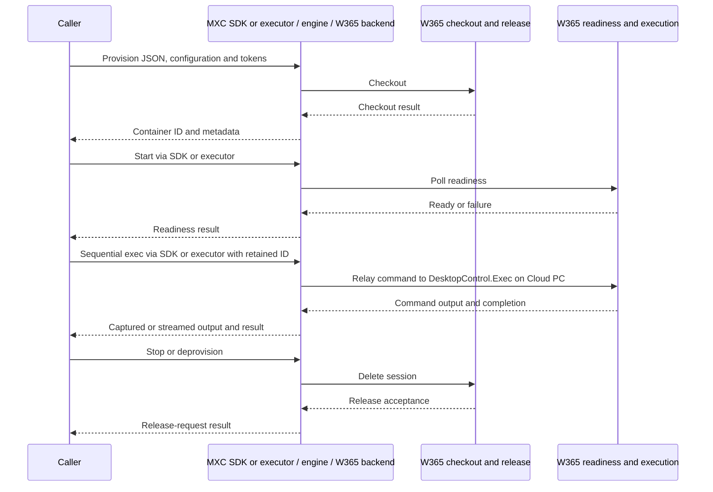

# Feature design: Windows 365 for Agents backend

> **Audience:** MXC developers

- **Status:** Proposed
- **Issue:** [#1615: Add new experimental backend for Windows 365](https://github.com/microsoft/mxc/issues/1615)
- **SDK usage and API proposal:** [Experimental JSON lifecycle and execution](api.md).
- **Contributor:** @tbyfield (proposal); W365 team (planned implementation).
- **Implementation PRs:** Not started.

The issue has `feature-accepted`; scope and contributor are agreed.
Design approval is pending.

## Problem and scope

An agent's host machine may lack access to corporate resources, required
Windows applications, or the organization's configured working environment.
[Windows 365 for Agents](https://learn.microsoft.com/en-us/windows-365/agents/introduction-windows-365-for-agents)
(W365A) provides pools of preconfigured, corporate-managed Cloud PCs where
those resources and tools can be made available. An MXC caller can use that
environment without requiring the same connectivity or software on its own
machine.

This integration will let MXC callers check out an existing, preconfigured Cloud
PC from a pool for their use, run commands using its configured corporate
connectivity and installed tools, and release it when finished. Checkout does
not create a new VM. Files and other guest state persist between commands on
the same checked-out Cloud PC, so an agent can carry out a multi-step workflow
rather than starting from a fresh environment for each command.

This design covers an initial, deliberately scoped experimental feature set:
checkout, readiness, command execution, and release, with caller-supplied
pool, identity, service coordinates, and credentials. It is not a complete
integration of all W365A capabilities. The non-goals below apply to this
milestone; any later expansion requires separate scope and design agreement.

Access to corporate resources depends on the selected Cloud PC's network
configuration, workload credentials, and permissions. MXC does not establish
that access or guarantee application SSO; W365A service credentials authorize
checkout and command execution, not access to every resource inside the guest.

MXC uses two distinct W365 service paths:

- **Checkout and release (control plane, CP):** `provision` checks out a Cloud
  PC; `stop` and `deprovision` release it.

- **Readiness and command execution (data plane, DP):** `start` checks readiness;
  `exec` sends commands through the W365 RemotingInterface service to
  DesktopControl.Exec on the checked-out Cloud PC.

These paths use separate endpoints and resource-specific tokens that are not
interchangeable. The `cp*`, `dp*` and corresponding environment-variable names
reflect this distinction. Successful checkout does not establish that
command execution is ready or authorized.

### Usage scenario

**Build an internal Windows project from an external agent host.** An agent
runs on a machine without access to the organization's internal source
repository or its Windows build tools. Here, the caller is the agent or client
application invoking MXC. It supplies a ready-to-use W365A pool GUID, approved
service coordinates, `HumanUser` identity information, and valid W365 service
tokens. The pool's Cloud PCs are already
configured with the required corporate connectivity, repository credentials,
and build tools.

The agent or client application invokes MXC's `provision` operation; the W365A
backend checks out a Cloud PC through the service and returns its
container ID. The application then invokes `start`, which polls the service
until the Cloud PC is ready or reports a failure. It invokes `exec` for each
command using that same ID. MXC sends the commands to DesktopControl.Exec on
the Cloud PC to retrieve the internal project, run its Windows build, and
inspect the build results.
The retrieved source files and build outputs remain available between commands;
the agent host needs neither direct repository access nor the Windows toolchain.
The agent or client application collects the required results through command
output and invokes `deprovision` through MXC in final cleanup, retaining the
container ID if release fails.

This is the initial user workflow. Guest-state retention and recovery from a
fresh caller process are supporting lifecycle requirements, covered below,
not separate reasons to choose W365A.

### Non-goals

- Pool creation, discovery or selection, Graph permissions, remote access probes,
  capacity ranking, and fallback to another pool.
- MXC sign-in, account brokering, token acquisition or refresh, application-only
  or agentic identities, and guest application SSO guarantees.
- Create-and-run execution, PTY, a persistent shell, automatic command replay,
  or hidden keepalive/replacement.
- Local mounts, workload network/proxy/UI/clipboard enforcement on the Cloud PC,
  provisioning a new VM, RDP/screen sharing, and a new daemon or workspace crate.
- Typed W365 request configuration and contract publication.

## Proposed behavior

For currently supported operations, see the
[backend guide](../../../../backends/w365agents/w365agents-backend.md).

The proposal adds experimental containment `w365_agents` and the
`w365Agents` phase settings.
Callers use MXC request JSON through the executor or the existing
Rust, .NET, and Node V1.Dev SDK APIs with experimental opt-in. The initial scope
includes SDK captured execution and pipe-backed process handles as well as
synchronous executor relay. [The API proposal](api.md) shows both workflows.
The caller supplies deployment coordinates and resource-specific tokens on
each invocation, including refreshed credentials for cleanup.

For each lifecycle `exec` request, MXC connects to DesktopControl.Exec on the
checked-out Cloud PC and sends the requested command, working directory,
environment overrides, and timeout. DesktopControl.Exec executes the command
on that Cloud PC. MXC relays stdin, stdout, and stderr over the connection and
returns the remote command's exit code on normal completion. The command does
not run on the machine hosting MXC.

| Operation | Service interaction | Observable result |
| --- | --- | --- |
| `provision` | Checks out a Cloud PC from the caller-selected pool through W365. | One checkout; opaque container ID and checkout metadata on success. |
| `start` | Polls the W365 readiness endpoint for the checked-out Cloud PC. | Returns only on `Ready`, or reports an explicit failure/timeout. |
| `exec` | Uses the W365 execution service to invoke DesktopControl.Exec on the checked-out Cloud PC. | Executor-relayed or SDK-captured/streamed output and remote exit code, or explicit abnormal outcome. |
| `stop` | Releases the checked-out Cloud PC through W365. | Terminal release request; `releaseRequested: true`, `restartable: false`. |
| `deprovision` | Same release operation as stop | Cleanup without requiring an earlier successful stop. |

Defaults and omitted/empty inputs are specified under
[Contracts, APIs, and compatibility](#contracts-apis-and-compatibility).

### Container identity

The proposed W365A backend will represent each Cloud PC checkout with an opaque
container ID, encoded as `w365:{poolId}:{sessionId}`, with canonical GUID
segments. This ID identifies the checkout; callers must not treat it as a
permanent Cloud PC identifier. They will pass it to subsequent lifecycle
operations. It will contain no credentials or endpoints.

For the supported pooled flow, the session ID also identifies the computer
used for readiness and execution. The MXC backend checks the returned IDs
before reporting successful provisioning and rejects a different computer ID.
If the computer ID is omitted, it uses the session ID under the supported
pooled-flow assumption.

A mismatched or malformed computer ID is an unexpected service response for
this supported pooled flow.
**A Cloud PC may already be checked out** when MXC rejects an inconsistent
successful response. The error reports `id_mismatch` and `possiblySucceeded: true`.
When the session ID is valid, a mismatched or malformed computer ID does not
erase that checkout's cleanup identity. The structured error retains
`details.poolId`, `details.sessionId` and `details.sandboxId`. The backend
constructs the cleanup reference as `w365:{poolId}:{sessionId}`; the caller
passes it unchanged as `sandboxId` to `deprovision` or `stop`, with valid
configuration and credentials for releasing the Cloud PC. Release targets
the session ID, never the mismatched computer ID.

The cleanup reference is not a successful provisioning result or assurance
that readiness or execution is supported. MXC does not automatically release
the Cloud PC or retry checkout. If the response cannot be parsed or the
session ID is missing or malformed, no cleanup reference is fabricated.

The caller will persist the returned ID and retain its account and deployment
context separately. The service will authorize each operation. Release will
not depend on an earlier runner object or a live exec connection.

## Execution and container lifecycle support

| Mode | Create-and-run | Checked-out W365 Cloud PC |
| --- | --- | --- |
| Run-to-completion with SDK-buffered output | No; lifecycle-only backend. | Yes, through the existing Dev run-in-container JSON API. |
| Live stdin/stdout/stderr | No implicit provision/exec/release wrapper. | Yes: synchronous executor `ExecStdio::Relayed` or SDK `ExecStdio::Piped` streams. |
| Returned piped process handles / nonblocking spawn | No. | Yes, through the existing Dev spawn-in-container JSON API. |
| Interactive PTY | No. | No; the trait's unsupported-phase refusal applies. |

Both the executor and Dev SDK support the complete Cloud PC checkout lifecycle.
SDK run-in-container captures output; spawn-in-container returns caller-owned
streams and a process handle without waiting for command completion.
SDK calls enter the engine directly, without launching an executor.

The useful order is provision, persist ID, start, one or more sequential execs,
then stop and/or deprovision. Start polls readiness and may be repeated.
Commands will share guest state, not a persistent shell. The caller sequences
commands; MXC does not serialize concurrent requests for a checked-out Cloud PC.
Releasing during exec may terminate useful work.

Stop releases the Cloud PC rather than suspending it. Start after release
does not check out a replacement. Another checkout requires an explicit
provision. The backend will report release acceptance, not completion of the
service's reset process.

`ExecStdio::Relayed` runs synchronously using the executor's own
stdin/stdout/stderr. `ExecStdio::Piped` exposes separate stdin/stdout/stderr
without using host stdio. Closing stdin forwards EOF without releasing the
Cloud PC.

Both modes report `ExecOutcome::Exited(code)` only after an actual `EXIT`
frame. All reported guest exit codes, including `-1`, are preserved.

Transport loss before `EXIT` or a remote `ERROR` returns
`MxcError::backend_error`, with distinct operation-specific `details.code`
values and explicit command-outcome uncertainty where the outcome cannot be
established. A remote `ERROR` retains available service failure context; it
does not imply a confirmed process exit or kill. The executor reports the
structured error on stderr, without appending it to workload stdout.
SDK lifecycle, exec launch and wait failures preserve the
[structured error details](api.md#errors-and-recovery).

Remote kill is unsupported. SDK kill reports unsupported remote termination;
local cancellation/disposal closes local I/O without releasing the Cloud PC.
A local deadline or disconnect must not produce a successful timeout result
without evidence that the remote command stopped after its timeout.

## Backend applicability and availability

This feature adds only W365A; it does not broaden another backend's capability.
Existing host checks and experimental classifications are retained.

| Backend | Planned support | Required host features and how they are checked | What the probe/availability API reports |
| --- | --- | --- | --- |
| `w365_agents` (new) | Yes; lifecycle-only remote backend. | An MXC-supported client OS and architecture, DNS/TLS access, valid W365 service credentials and an assigned pool with compatible DesktopControl.Exec. No W365-specific client OS or architecture restriction. | `ProbeCoverage::NotDetected`; omitted from local availability results. Local probing cannot determine remote usability. |

The backend implementation is included in normal builds on supported client
platforms; it has no opt-in Cargo feature.
Every phase still requires runtime
experimental authorization: `--experimental` for the executor or the Dev SDK's
`JsonOptions` experimental flag, even when its request contract parses.
Missing authorization returns `backend_unavailable` before backend execution.
Configuration JSON cannot grant that authorization.

Client support follows MXC's supported operating systems and architectures.
The TCP/rustls transport does not require local virtualization or a particular
Windows build. Guest support is determined independently by the W365 service:
the caller must have a supported pool with compatible DesktopControl.Exec.
The client's architecture does not need to match the Cloud PC's architecture.
Credentials, pool access and exec capability are checked by the relevant
service operation, not a local probe or trial checkout.

## Contracts, APIs, and compatibility

**Request contract changes: Yes. Public SDK API changes: Additive error metadata;
existing invocation signatures are unchanged. Existing published compatibility
changes: No.** The new request fields are limited to the mutable
`1.1.0-alpha` development contract. `schemas/stable/` and the published
`1.0.0` types remain unchanged.
The [version registry](../../../../../schemas/schema-version.json) currently
sets `maxSupported` to `1.1.0-alpha`, `stableLatest` to `1.0.0` and SDK major 1
to `1.0.0`. This proposal changes neither publication nor SDK targets.

The field subset and human-user identity omission rules below require owner
agreement before the contract PR.

### Routing and phase settings

MXC request JSON has `version: "1.1.0-alpha"` and one of `phase: "provision"`,
`"start"`, `"exec"`, `"stop"` or `"deprovision"`. Provision selects
`containment: "w365_agents"`; later phases route by top-level `sandboxId`.
Direct executor calls use existing `--operation` and `--container-id` controls
for those routing values. No new CLI operation or SDK entrypoint is proposed.

Only provision accepts `w365Agents.provision`; start, exec, stop and deprovision
use the ordinary `sandboxId` and process contracts and reject `w365Agents`,
including an empty object. Unknown fields are rejected, not ignored. Provision requires
`w365Agents.provision.poolId`: absent `w365Agents`, `{}`, or a missing phase
object fails backend validation; a supplied empty provision object lacks the
required field and fails contract parsing. Null is not an alternative to
omission. Parsers preserve presence; backend code owns defaults.

| Field | Allowed input and omitted/empty behavior |
| --- | --- |
| `w365Agents.provision.poolId` | Required string, 36-character hyphenated ASCII-hex GUID (`8-4-4-4-12`). No empty/blank value or automatic selection. |
| Provision `userType` | `"Local"`, `"HumanUser"`, or `"Agentic"` when supplied; empty/other values fail. Omission sends no `user-type` header; MXC does not select an identity or session kind. |
| Provision `userObjectId` | If supplied, a canonical GUID sent as `user-object-id`; empty/blank fails. Omission sends no header. |

Service configuration belongs to the caller environment, not request JSON.
Checkout and release require `W365A_CONTROLPLANE_URL` (a bare ASCII DNS
hostname without scheme, port, path, query, credentials or whitespace) and
`W365A_CP_TOKEN` (a nonempty resource-specific bearer token without whitespace
or control characters). Missing, blank, invalid or non-Unicode configuration
fails locally; MXC does not acquire or renew tokens. Read configuration again
for each invocation, including release in a fresh process with renewed credentials.
The existing design budgets are 45000 ms for checkout and 30000 ms for release;
there are no per-request timeout overrides or new renewal mechanism.
Readiness and exec environment settings remain deferred with their implementation.

Service defaults are HTTPS port 443, checkout/release API `2.0`, readiness API
`1.0` and exec capability `microsoft.mxc-exec`. Additional
protocol/port/capability overrides are outside the proposed initial scope.

#### User types

`userType` describes the account used for the Cloud PC session, not whether
an agent or a human invokes MXC:

| Value | Meaning |
| --- | --- |
| `Local` | Windows runs the session under a local account, not the selected owner's Microsoft Entra identity. `userObjectId` identifies the remote-control owner. No auxiliary token is allowed. |
| `HumanUser` | A session for a human user's Microsoft Entra identity. An optional auxiliary token enables assertion-based startup and must represent that same human user. |
| `Agentic` | A session for a Microsoft Entra Agent User identity. An auxiliary token is required and must represent the Agent User identified by `userObjectId`. |

### Process inputs and results

Only exec takes `process`. `commandLine` is a required nonempty string, executed
by the remote DesktopControl.Exec host, not by a new local shell.
`cwd` is an optional guest path; omitted or `""` omits `cwd` from the relay
payload. When omitted, exec currently uses the DesktopControl.Exec host process's
working directory, normally its executable directory under the DesktopControl
host launcher. This default is subject to change; specify an absolute guest path
for predictable behavior.

`process.env` is an optional array of `KEY=VALUE` strings.
`process.inheritDefaultEnv` defaults to false and controls whether supplied
entries replace or extend the guest's default environment. The remote service
supports additions and overrides, but cannot replace or empty that environment.

| `process.env` | `process.inheritDefaultEnv` | Behavior |
| --- | --- | --- |
| Omitted | Omitted, false, or true | The command uses the guest's default environment. |
| Supplied, including `[]` | True | Supplied entries extend the guest's default environment and override matching variables. An empty array leaves the default unchanged. |
| Supplied, including `[]` | Omitted or false | MXC returns `policy_validation` before connecting to the remote execution service; environment replacement is unsupported. |

Accepted entries split on the first `=`; an entry without `=` has an empty
value, and the last duplicate key wins. No environment from the machine
running MXC is forwarded.

`process.timeout` is unsigned 32-bit milliseconds, defaults to 0 and is sent
as `timeoutMs`. Zero imposes no local MXC command deadline; execution remains
subject to service-side timeout defaults and limits, so it does not guarantee
unlimited runtime or checkout lifetime. A positive timeout is enforced by
the remote exec protocol, not a local process-tree kill guarantee.
Invalid types and unknown fields fail parsing.
The encoded `EXEC_START` and each frame have a 64 KiB payload cap; oversized
start payloads fail before connecting.

For example, the following `process` fragment belongs in a lifecycle `exec`
request; it is not a complete request:

```json
"process": {
  "commandLine": "cmd.exe /c echo %BUILD_MODE%",
  "cwd": "C:\\work",
  "env": ["BUILD_MODE=release"],
  "inheritDefaultEnv": true,
  "timeout": 5000
}
```

Assuming `C:\work` exists on the checked-out Cloud PC, the command runs there with
the guest's default environment plus the `BUILD_MODE` override. It prints
`release` to stdout and returns exit code 0 on normal completion. The remote
service receives a 5,000 ms command timeout.

Provision returns the opaque ID and `sessionId`, resolved `computerId`,
`status`, and optional service connection metadata. Start returns `Ready` and
the native exec capability. Release returns
`releaseRequested: true`, `restartable: false`.
Service errors use existing `MxcErrorCode` values with operation-specific
`details.code`, HTTP status and request ID where available.

### Request schema generation and SDK scope

Phase-specific closed Rust types define the new request settings. Adapters
preserve their field presence in private normalization input, and checked
binding carries them into the backend. The Rust definitions generate
`schemas/dev/mxc-config.schema.1.1.0-alpha.json` and
`sdk/node/src/generated/v1_1_0_alpha/wire.ts` through the process described in the
[schema codegen guide](../../../build-and-test/schema-codegen.md).
Generated TypeScript does not add a public SDK export.

Existing SDK error conversion can discard backend details, including the
sandbox ID. Preserving those details lets callers explicitly release a
checked-out Cloud PC even when provisioning returns an error.
[The API proposal](api.md) defines additive SDK error metadata so available
backend details, including the cleanup ID, survive SDK lifecycle and exec failures.
Executor exec failures retain their structured stderr reporting.
Existing invocation signatures and C ABI layouts remain compatible.
Typed V1 requests still target `1.0.0`; W365A uses development JSON through
the Dev APIs, without new typed W365 configuration.

## Design and security

The W365A backend resides in `mxc-sdk` modules under
`src/mxc-sdk/src/backends/w365agents/common/`. `W365AgentsRunner` implements
`StatefulSandboxBackend` and delegates configuration, W365 service requests,
readiness and command relay to those internal modules.
`mxc_engine` owns experimental authorization, registration, checked dispatch
and ID routing. Executors remain thin. `mxc_contract` owns contract definitions;
`mxc_common` provides shared request normalization and the cross-platform
foundation, not contract or backend implementation.

Command execution reaches the Cloud PC through the W365
RemotingInterface service. DesktopControl.Relay on the Cloud PC establishes
the outbound service connection and carries commands and I/O to and from
DesktopControl.Exec. The relay transports the data; DesktopControl.Exec
launches the command. These guest components are deployment prerequisites,
not components installed by MXC.

Piped execution reuses the existing `ExecHandle`/`ExecSandboxProcess` adapters.
The W365 backend owns its transport resources.



**Isolation/trust changes: Yes.** The boundary is a tenant-managed remote Cloud
PC, not a local sandbox. MXC rejects host filesystem/mount, network, proxy,
UI and clipboard policy it cannot enforce before checkout or any later remote
action. Provision/non-exec closed types exclude such sections; exec rejects
supplied network or `runtimeConfig.networkProxy`, including empty/default
blocks, through backend policy validation.

Connections use TLS certificate validation and bounded frame/HTTP parsing.
The backend validates GUIDs, hosts and header values before dialing and rejects
credential-bearing URLs and control-character injection. An explicit nonblank
host requires a matching explicit nonblank token; the backend does not use
ambient tokens for host overrides. It does not follow redirects, connect to
URLs returned by the service, or forward credentials to an unrelated origin.

The caller keeps tokens out of source, examples, command-line arguments and
persistent request files. Diagnostics redact tokens and ticket-bearing
`connectivityUrl`; returned connection metadata, remote
stdout/stderr and bounded checkout audit context are intentional outputs.
The existing Windows-only, explicit-consent telemetry policy remains unchanged;
audit records do not create a new consent path.

**Alternative:** wrapping a local VM or adding another command-runner/identity
broker would not address checkout from an existing remote pool and would
duplicate lifecycle ownership.

## Resource ownership and failure recovery

| Owner | State/resources and cleanup responsibility |
| --- | --- |
| Caller | Chooses pool, identity, coordinates and credentials; persists ID immediately; sequences commands; drains and disposes SDK-spawned process streams/handles or manages executor stdio; retains primary and cleanup results separately; attempts stop/deprovision with renewed credentials for release. |
| MXC backend adapter | Validates and executes one phase; owns temporary connections, bounded stream buffers and relay workers. It has no durable checkout registry or checkout watchdog. |
| W365 services / guest | Own checkout state, remote command processes, guest files/environment, tenant policy, expiration and reset. Their continued state does not depend on retaining a runner object. |

Successful exec closes its transient connection without releasing the Cloud PC.
SDK capture owns and disposes its transient process handle; spawn transfers
ownership to the caller, who drains stdout/stderr concurrently and closes stdin
when done.
Relay buffers are bounded and output loss is an explicit error; full SDK capture
uses memory proportional to output size. Completion, failure and disposal must
unblock SDK-local I/O without waiting for remote completion. The executor's
relayed stdin reader may remain blocked until input/EOF or process exit.
Neither process disposal, executor termination nor host exit releases the Cloud PC.
Service expiration or reset can lose guest work; callers checkpoint valuable
results outside it.

| Failure or transition | Remaining state and caller-visible recovery |
| --- | --- |
| Request rejected locally | Invalid configuration, policy or ID fails before a service request, so the rejected operation causes no remote action. |
| Checkout rejected with a known session ID | A mismatched or malformed computer ID does not prevent explicit release of a valid session. The caller retains `details.sandboxId` from the error and passes it unchanged to `deprovision` or `stop` with valid credentials for release. If release fails, it retains the reference and reports the checkout and cleanup failures separately. |
| Checkout outcome unknown or session ID unavailable | A lost/unparseable response or lost/malformed session ID can leave a Cloud PC checked out without a cleanup reference. Uncertain checkout errors report `possiblySucceeded` and available request context. MXC does not automatically retry checkout, guarantee release, or reconstruct a lost ID. Service-side reconciliation is outside this milestone. |
| Readiness failure | The checked-out Cloud PC is not automatically released or replaced. The caller can retry readiness with the retained ID and valid credentials, or explicitly release it. |
| Execution failure or caller disconnect | Connection loss, remote `ERROR` and local I/O/protocol failures return structured MXC errors through SDK launch/wait or executor stderr, not synthetic command exits. Failed SDK capture returns an error, not a partial successful result; already-read spawned output remains the caller's. No confirmed remote cleanup is inferred, and commands are never replayed automatically. |
| SDK process kill, cancellation or disposal | Local resources are closed without releasing the Cloud PC or proving remote termination. Explicit kill reports unsupported remote termination. The caller retains the ID for explicit release. |
| Executor termination or host exit | Local process/socket resources are reclaimed without releasing the Cloud PC. Closing the connection does not prove the remote command stopped. The caller retains the ID for explicit release through the SDK or executor. |
| Release failure or lost response | The Cloud PC may remain checked out, or release may already have been accepted. The caller retains the ID and deployment/account context, reports cleanup failure separately from the original failure, and retries release against the same ID with valid credentials for release under a separate cleanup budget. |
| Release accepted, checkout expired, or later checkout | Release is idempotent, but acceptance does not confirm completed reset/sanitization or reusable capacity. Expired checkouts surface service errors, not an implicit replacement or restoration of guest data. A new checkout is independent and does not clean up an earlier checkout; the caller retains its ID for cleanup, and leaked capacity may cause the new checkout to fail. |

MXC has no durable checkout registry or service-confirmed remote cancellation
handle.
Request correlation may be unavailable when telemetry is off or authorization
fails; diagnostics are not a guaranteed way to recover a lost container ID.

Release has a 30000 ms HTTP timeout. Phase deadlines are client budgets, not
hard guarantees over DNS, poll sleeps, service reset or remote process lifetime.
Cleanup uses a separate budget, not an already-cancelled work deadline. The Phase 4 examples
report both primary and cleanup results. Local result-construction failure
also does not trigger compensating release.

## Acceptance criteria and validation plan

The proposed test groups below form the implementation's CI acceptance criteria.
Unit/codec tests support, but do not replace, functional lifecycle validation.
The [execution-mode support table](#execution-and-container-lifecycle-support)
defines the lifecycle-only API boundary: create-and-run APIs are unsupported,
while exec on a checked-out Cloud PC supports executor relay and SDK capture/spawn.
[SDK-specific checks](api.md#validation-and-documentation) supplement
the shared scenarios below.

### Observable assertions

| Proposed test group/scenario | Action/input | Required assertion |
| --- | --- | --- |
| `mxc_contract_v1_1_0_alpha` W365 fixtures | All five phase requests, missing/empty/null/wrong-phase fields; published 1.0 requests. | Development fields parse only in their phase/version; preserve optional presence, reject unknowns/nulls; published fixtures and schemas unchanged. |
| Engine authorization/binding tests | Invoke every phase through normal executor and Dev SDK builds, without experimental opt-in, then authorized. Repeat with the backend omitted. Include relayed/piped exec and unsupported create-and-run, placement-session and PTY requests. | Contract parsing is unchanged when the backend is omitted; missing backend or opt-in fails before backend work. No network for unsupported modes, no authorization through JSON; checked dispatch accepts relayed and piped exec. |
| `w365agents_lifecycle` native fixture (new) | Unsupported filesystem/network/UI/clipboard/proxy blocks, including empty/default policy blocks, and malformed IDs. | Contract or backend validation fails before any checkout/status/upgrade/delete request; fixture records zero requests. |
| Lifecycle/config fixture | Omitted/empty provision wrapper, missing/blank/invalid environment host or token, and rejected per-call overrides. | Presence follows the Phase 1 contract; missing configuration fails before requests; no per-call host or token is accepted. |
| Lifecycle environment fixture | Omitted `process.env`, `[]`, and supplied entries, each with omitted/false/true `inheritDefaultEnv`. | Accepted requests forward only supplied entries, with none for omitted/empty env; the inheritance flag is not forwarded. Supplied env with false/omitted fails with `policy_validation` before any remote connection. No MXC host environment is forwarded. Actual guest inheritance and overrides are checked in the Phase 4 live scenario below. |
| Lifecycle process-input fixture | Command with omitted/empty/supplied `cwd` and omitted/zero/positive `process.timeout`. | The service fixture receives the unchanged command, no `cwd` for omitted/empty input or the supplied guest path otherwise, and `timeoutMs` of 0 for omitted/zero input or the supplied positive millisecond value. |
| Phase 4 live process-input scenario | Execute through the native lifecycle path in a known guest directory, with known non-sensitive guest-default variables and an override of one using `inheritDefaultEnv: true`. Repeat with omitted env and with `env: []` plus `inheritDefaultEnv: true`; run with omitted and zero `process.timeout`, then run a command whose normal duration exceeds a positive timeout. | Output identifies the selected directory, preserves the unmodified guest-default variable and reflects the override; omitted/empty env preserves guest defaults. Confirm and record guest handling of zero `timeoutMs` and applicable service-side timeout defaults and limits. The positively timed command terminates remotely without reaching normal completion; record the returned exit/error result. A local timeout or disconnect alone does not establish remote termination. |
| `w365agents_cp_loopback` plus lifecycle fixture | Equal IDs or omitted computer ID; different/malformed computer ID with a valid session ID; lost response, unparseable body or missing/malformed session ID. | Equal/omitted computer IDs produce the same session-based ID. Rejected successful checkout reports `possiblySucceeded`; a valid session ID is retained with the pool ID and opaque `sandboxId` in error details, not a successful container result. An unavailable/invalid session ID produces no fabricated cleanup reference. No second POST occurs. |
| Checkout/release/status/upgrade failure fixtures | 401, 403, 404, 429, 500, other non-success and malformed responses. | Errors retain operation-specific categories/request IDs; 500 checkout reports uncertainty; no automatic retry/fallback/escalation occurs. |
| Readiness fixture (later stage) | Waiting/Live then Ready, unknown state and expired budget; environment configuration/budget controls to be finalized in Phase 3. | Success only on Ready; timeout has last state; no release or replacement on timeout. |
| `w365agents_loopback` and lifecycle relay fixture | Input/EOF, stdout/stderr frames, EXIT 0, 7 and -1, oversized start payload, oversized/malformed received frames, loss before EXIT, remote ERROR and local output error. | I/O and actual EXIT codes are preserved, including -1. Oversized EXEC_START fails before dial; oversized/malformed received frames fail explicitly. Post-upgrade loss and remote ERROR return `backend_error` with distinct operation-specific codes and appropriate outcome-uncertainty details, not `ExecCompleted`; local failures also surface errors. Native errors go to stderr without altering already-relayed stdout, and commands are never replayed automatically after failure. |
| Executor relay lifecycle fixture | Concurrent stdout/stderr of at least 1 MiB each, binary data, stdin/EOF and slow/closed output readers through executor relayed exec. | Exact separate output with concurrent draining; bounded relay buffers and explicit local I/O errors. EOF is forwarded without checkout or release. |
| Rust/.NET/Node Dev lifecycle fixture (new) | Provision, start, repeated captured/spawned exec, stop and deprovision through each SDK with normal native libraries; repeat without experimental opt-in. | Same checked-out Cloud PC, complete lifecycle responses, separate output and actual exits; no executor subprocess or implicit release. Missing opt-in fails before network activity; PTY/create-and-run remain refused. |
| SDK piped execution fixture | Concurrent large stdout/stderr, binary data, stdin/EOF, slow/untaken readers, launch failures and disposal during blocked I/O. | Exact separate output or explicit output/I/O errors; no host stdio use. EOF and local cleanup complete without release or waiting for remote `EXIT`. |
| SDK error/recovery fixture | Rejected checkout with valid session ID, readiness/exec launch/wait failures, remote `ERROR`, release failure, explicit kill and local deadline. | SDK errors retain backend details. The error's `sandboxId` permits release through the same SDK; primary and cleanup failures are retained. No fabricated IDs, exits, remote kill or timeout claims. |
| `w365agents_correlation_loopback` and TLS fixtures | Correlation off/on, secrets in config/metadata, invalid certificates, host/header injection and redirect responses. | No blank correlation header, no leaked token/ticket in diagnostics; TLS cannot be bypassed in production; no redirect or credential forwarding. |
| Lifecycle release/recovery fixture | Deprovision using `details.sandboxId` from a rejected checkout with a valid session ID; exec fails, release fails/response is lost, caller retries release with retained ID and renewed token; response 200/202/204/404. | Release uses the validated session ID, not the mismatched computer ID, without requiring successful start/exec or another checkout. Primary and cleanup results are both retained; retry targets the same session only; report acceptance without reset completion. |
| Lifecycle subsequent-creation fixture | After failed cleanup of checkout A, explicitly provision B, then retry cleanup A. | Exactly one new checkout; distinct returned IDs; cleanup A never targets B; no hidden cleanup/reallocation or shared local registry corruption. |
| Lifecycle process-exit fixture | Kill/exit a test executor during command or after provision; invoke fresh executor with persisted ID. | Local process/socket resources reclaimed; no false claim of remote kill or Cloud PC release; fresh request routes same retained ID without checkout. Real guest outcome remains a manual-service assertion. |
| Probe/registry regressions | Probe normal builds and compare other backend results; check W365's experimental registration. | W365 is not locally asserted available; no auth/network call; existing backend capabilities/experimental classifications unchanged. |

### CI suites and hosts

The CI jobs below will explicitly select and run the W365 tests in normal
builds, with selected-test/pass-count checks. Existing OS and architecture
matrices remain in place; W365 tests must not be restricted to Windows x64.
Proposed additions:

| CI workflow/job | Proposed coverage and prerequisites |
| --- | --- |
| `.github/workflows/Build.Windows.Job.yml`, `Build.Linux.Job.yml` and `Build.MacOS.Job.yml`, existing OS/architecture jobs | Build/test `mxc-sdk`, `mxc_ffi` and executors with W365 included in normal artifacts. Run the contract, engine, error-transport and loopback/native/Rust Dev lifecycle, execution and recovery fixtures above on the existing Windows/Linux x64 and arm64 and macOS arm64 jobs. Retain refusal without experimental opt-in and existing backend coverage. Build CI requires no pool or tenant credential. |
| `.github/workflows/SDK.Unit.Test.Job.yml`, `SDK.Integration.Test.Job.yml` and `SDK.Dotnet.Test.Job.yml`, existing OS jobs | Run Node/.NET Dev lifecycle, capture/spawn and recovery fixtures against normal `mxc_ffi` artifacts, with selected/pass-count gates and .NET error-details/AOT coverage. Preserve existing SDK/backend matrices. |
| Phase 4 manual examples (new; not scheduled CI) | Prerequisites are normal executor/SDK/native artifacts for an MXC-supported client, a W365-supported Cloud PC with compatible DesktopControl.Exec, a suitable tenant/pool and approved caller-supplied human identity/tokens. Exercise the complete workflow with experimental opt-in through the executor and each Dev SDK, including captured/streamed output, the live process-input assertions above, guest-state retention, fresh-process recovery, nonzero exits, expiry/transport failure, cleanup failure/retry and terminal release. Results identify actual client/guest platforms, outcomes, leftover IDs and scenarios not exercised. |

Lifecycle fixtures will invoke the normal executor and in-process Dev SDK paths against
controlled service responses, with test-only trusted TLS that does not weaken
production validation. Codec loopbacks supplement that coverage; pure tests
cover deterministic poll clocks and frame limits. Interop tests need a
compatible DesktopControl.Exec host; skipped tests do not count as coverage.

A two-machine execution demo using real MXC and DesktopControl components but
pre-seeded pool/computer authorization exercises the remote execution path,
not the complete checkout lifecycle. Simulated checkout does not validate
W365 service provision, readiness, or release, and is not a substitute for
the Phase 4 live lifecycle scenarios.

### Live-test inputs and nightly validation

Here, **scheduled live validation means adding W365A integration tests to MXC's
nightly validation suite against a real W365 tenant and pool**. The existing
`.github/workflows/Validation.Tests.Scheduled.yml` entry point runs
`test-nightly`, which calls `Validation.Tests.Matrix.Job.yml` with `plan: nightly`
and tests downloaded build artifacts, as described in the
[validation runbook](../../../build-and-test/ci-validation-infrastructure.md).
W365A is not currently wired into that suite.

The proposed build-CI contract, loopback and native lifecycle fixtures use
controlled service responses and synthetic credentials; they require no live
tenant credentials or Cloud PC checkouts. The Phase 4 manual live examples
use real service access but run only when explicitly invoked. They are the
initial milestone's live-validation path, not a nightly test.

Both manual and nightly live tests require a configured W365A test tenant,
the required licenses assigned to the test users or resources, and an
authorized pool with ready-to-use Cloud PCs. This is a maintained service
environment, not just a CI job supplied with a token. Ongoing ownership covers
tenant configuration, license assignments, pool capacity, guest configuration,
test identities and permissions, and associated service costs. These
dependencies make reliable live coverage non-trivial to establish and maintain.

The manual harnesses, and a future nightly harness, supply the provision request
through the executor or Dev SDK JSON path with experimental opt-in. The inputs
follow the [phase settings](#routing-and-phase-settings):

| Provision input | What the live-test harness supplies |
| --- | --- |
| Request routing | `version: "1.1.0-alpha"`, `phase: "provision"` and `containment: "w365_agents"`. |
| `w365Agents.provision.poolId` | Required canonical 36-character pool GUID for an existing, authorized test pool. The harness selects the pool; MXC does not discover or create it. |
| `userType` and `userObjectId` | The delegated human-user scenario supplies `"HumanUser"` and the selected user's canonical object GUID. Both fields are optional in the proposed MXC contract; omission sends no corresponding header and does not infer a human identity. The caller supplies the identity information required by its service deployment. |
| Service configuration (environment only) | Supply `W365A_CONTROLPLANE_URL` and `W365A_CP_TOKEN` in the caller environment. Neither belongs in the provision document. |

Stop/deprovision use the checkout/release environment again, including
caller-renewed credentials when needed for cleanup. Readiness and exec are
not available in Phase 2.

Nightly live testing is proposed as follow-up beyond the initial experimental
milestone. Unattended runs require an authorized test tenant, pool and identity,
secure credential injection that keeps tokens out of checked-in request files,
command-line arguments and logs, approved token acquisition/refresh arrangements,
and runner/workflow setup using normal artifacts with experimental opt-in.
These arrangements and their ownership are not yet established. MXC does not
acquire or refresh tokens, and this plan introduces no new authentication mode.

This deferral requires maintainer agreement in #1615 and an infrastructure
owner under the [validation runbook](../../../build-and-test/ci-validation-infrastructure.md).
The manual example is not equivalent to scheduled service coverage.
No current gate is removed or weakened.

## Delivery and documentation

Delivery follows the current
[feature guide](https://github.com/microsoft/mxc/blob/main/docs/development/guides/authoring-a-new-feature.md).
Design approval and merge precede implementation, including draft implementation
PRs. Implementation PRs use the non-closing reference `Refs #1615`.

| Stage | Reviewable change |
| --- | --- |
| Phase 1: contracts and generated artifacts | A separate PR introduces development phase types, adapters, fixtures and generated schema/TypeScript artifacts. Published contracts remain unchanged; the unsupported backend stays unavailable until implemented. |
| SDK error-metadata prerequisite | A separate PR preserves backend details through Rust, native error transport, .NET and Node as specified in [the API proposal](api.md), with compatibility and regression coverage. |
| Phase 2: checkout and release | This stage establishes the direct-user contract and introduces the internal runner, ID mapping, W365 service client for checkout and release, fail-closed policy, engine registration/dispatch with runtime experimental authorization, normal-build inclusion and checked binding as a vertical slice. Executor and Dev SDK fixtures verify checkout/release and error-based cleanup with CI wiring. |
| Phase 3: readiness and execution | This stage introduces W365 service readiness checks, TLS upgrade, executor relay and SDK pipe-backed capture/spawn through existing adapters, with cross-SDK execution/recovery and unsupported-mode coverage. |
| Phase 4: manual examples and documentation | This stage provides executor-only and SDK-only lifecycle/execution examples using normal artifacts with experimental opt-in, sequential guest-state and recovery scenarios, and the backend guide. The accompanying results identify actual client/guest platforms, manual outcomes and unresolved live-infrastructure limits. |
| Typed W365 SDK/API stage | Outside this milestone; typed request APIs and contract targets remain unchanged. Future publication/typed API work needs separate agreement. |

Implementation includes updates to the canonical documentation: `docs/schema.md`,
`docs/containment-policy/dev/policy.md`, a new
`docs/backends/w365-agents/w365-agents.md`, lifecycle/backend plug-in and
repository architecture references, feature authoring/versioning, validation infrastructure,
and the examples' usage/prerequisites. SDK README and versioned Dev/error
reference updates are listed in the [API proposal](api.md#validation-and-documentation).

## Open questions

None for the proposed initial scope.

## Review checklist

- [x] The issue has maintainer-applied `feature-accepted`; scope and contributor are agreed.
- [x] One or two meaningful usage examples, non-goals, defaults, and failure behavior are clear.
- [x] Every backend is considered, with explicit capability checks and probe/availability behavior.
- [x] Execution modes and container lifecycle support are explicit; exclusions are explained.
- [x] Resource ownership, partial failures, failed cleanup, and subsequent container creation are addressed.
- [x] Security, contract/API compatibility, and any breaking changes are addressed.
- [x] A separate API proposal covers Dev SDK usage, native error details and Provision cleanup IDs in error messages; typed W365 APIs remain out of scope.
- [x] Acceptance criteria and the CI plan cover observable behavior.
- [x] Delivery and documentation changes are scoped; material questions are resolved.
- [x] Answers are concise; diagrams explain the design without repeating the text.
- [ ] Maintainers have approved the spec and its status is Accepted before merge.
