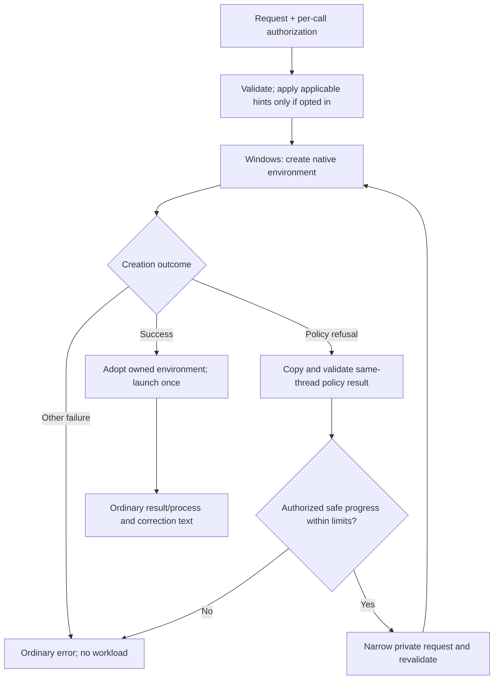

# Feature design: Windows creation-policy diagnostics and restrictive correction

> **Audience:** MXC developers

- **Status:** Proposed
- **Issue:** [#1634](https://github.com/microsoft/mxc/issues/1634)
- **Contributor:** @rossnichols
- **Implementation PRs:** Not started; maintainer scope acceptance and spec approval are pending.

This draft proposes native Windows creation diagnostics and caller-authorized
restrictive correction. Public declarations and caller examples are in the
separate [API proposal](api.md). Neither document grants implementation or
release approval.

## Problem and scope

An application or coding agent can request an MXC container that Windows
administrative policy refuses. A generic creation error does not explain which
permission caused the conflict. Callers need useful guidance and, when they
explicitly authorize it, a way to accept fewer permissions without implementing
Windows policy negotiation themselves.

Two usage scenarios:

1. **Explain a strict refusal.** A request grants read-write access to
   `C:\work\repo`, but the creator is governed by a read-only ceiling there.
   Ordinary creation fails without launching the command. Its existing error
   includes the native failure and, when available, the conflicting grant and
   guidance to narrow it. No caller object or file changes.

2. **Create with fewer permissions and live input.** The same request opts
   into correction and starts a command that reads stdin and only needs to read
   the repository. MXC lowers the matching grant to read-only, creates the
   environment, launches once, and returns a live process plus correction text.
   The caller writes input, closes stdin, drains output, waits and releases the
   process. A later opted-in invocation in the same creator context can reuse
   that restriction while retaining its current certificate and proxy inputs.

Non-goals: overriding administrative policy; switching isolation tier/backend
to evade refusal; changing workload code; relaxing permissions to obtain success;
mutation during container lifecycle operations; a public typed policy-change
report; disk-persisted decisions; or a caller-owned cache API.

## Proposed behavior

### Strict creation

- Default behavior remains strict. No correction or cached restriction is
  applied unless that invocation opts in.
- On `CreateProcessSecurityEnvironment` policy refusal
  (`0x800704EC`), add basic administrative-policy guidance to the existing
  error. Preserve the native operation, HRESULT and failure category.
- When Windows advertises the versioned policy-result API, request diagnostic
  capture internally before creation. This diagnostic opt-in is not permission
  to mutate, enable denial tracing or use an experimental backend.
- Retrieve refusal details on the failed native thread before cleanup,
  callbacks or another creation can replace its snapshot. Successful creation
  and non-policy errors do not query that snapshot.
- Validate the result before producing actionable guidance. Missing, invalid,
  incomplete or unknown details cannot replace the creation failure or become
  guessed instructions.

The proposed optional getter is
`Experimental_GetLastProcessSecurityEnvironmentPolicyResult`, resolved from
the same System32 `processmodel.dll` used for creation. Request its V1 PSEP
format; verify the identifier, structure, version/minimum-reader version,
flags and resource encoding before copying details. Guard every returned
allocation with `CoTaskMemFree`, including unexpected non-null failure output.

### Caller-authorized correction

Authorization belongs to the API call's options or `wxc-exec --mutate-policy`,
not MXC request JSON. Omitted authorization and `false` both mean strict
creation; an empty request is still invalid under the existing contract.

For an opted-in, serviceable native ProcessContainer request:

| Recognized constraint | Permitted correction |
| --- | --- |
| Forbidden effective capability | Remove the capability and every understood enabling network/capture setting. Removing a proxy must not activate direct-network allowances that were ineffective in proxy mode. |
| Forbidden permissive learning or logging | Disable the corresponding behavior, or change capture from allow to block when that satisfies the constraint. |
| Read-only filesystem ceiling | Lower an existing matching writable path to read-only; do not introduce a grant from a diagnostic witness or downgrade an unrelated ancestor. |
| No-access filesystem ceiling | Add a deny exception and remove only coincident grants, preserving other restrictive exceptions. |
| Path-count ceiling | Remove exact duplicate entries only; never discard distinct restrictive rules or broaden a grant. |

Only a recognized blocked-policy result with complete, actionable details
can authorize repair; evaluation failure is not a correction instruction.
Apply the whole understood batch to a private request copy and revalidate it
before retrying. Unknown actions, contradictory constraints, unsafe aliases,
malformed paths, unresolved canonicalization and unsupported policy stop the
repair. Enumeration-only paths remain unchanged and outside the data-access
path-count remedy. Normal backend validation still applies to them.

The proposed bounds are eight creation attempts including the first; 128 KiB
of native result bytes; 64 details; 32,768 UTF-16 resource-accounting units;
256 KiB of added refusal text; and 1 MiB of correction text. Filesystem
resolution uses the existing five-second per-probe wait and bounded worker
pool. These are limits on work and retained data, not a hard end-to-end startup
deadline: native creation/getter calls and lock acquisition remain synchronous.

Success returns the ordinary result or process. Newly negotiated corrections
appear as strings beginning `Sandbox configuration updated due to IT policy`.
Failure returns the ordinary error, with why correction stopped and any earlier
attempted changes; it does not return a successfully created process.
These descriptions are text, not stable typed change records.

SDK error/warning fields are separate from workload streams. CLI envelopes
share stderr with workload output; JSON shape does not authenticate their
origin. Callers must not scrape that mixed stream as a trusted control channel.

### In-process reuse

- Remember successful narrowing hints, not whole requests or creation approval.
  Partition them by process/effective token identities and modification IDs.
- Reapply only applicable restrictions to each fresh opted-in request, then
  validate and create through Windows again. Keep unrelated grants, certificate
  paths, proxy values, command, environment and identity from that request.
- Reuse alone emits no correction warning. Further refusals can add restrictions;
  report only the new corrections. Strict calls bypass this state.
- Learn only after successful native environment creation. A later launch,
  trace or workload failure does not invalidate the restriction or cause replay.
  Failed negotiation must not replace a successful entry.
- Bound retained hints to 16 entries and 4 MiB per loaded native module.
  Eviction, identity changes, process exit or module unload require fresh
  negotiation. Cache problems are reported without bypassing Windows creation.

## Execution and container lifecycle support

| Operation | Planned behavior |
| --- | --- |
| Captured create-and-run | Strict diagnostics and opted-in correction; ordinary output/timeout results remain. |
| Create with live pipes, including stdin | Same correction semantics. Prepare stdio/environment/capture from the effective request and launch once. |
| Create with a PTY | No mutation control; explicitly reject attempted authorization. Existing non-mutation behavior remains. |
| Provision, start, execute in an existing container, stop, deprovision | Unchanged; no correction option. This proposal does not add a persistent ProcessContainer lifecycle. |
| Probe, discovery, dry-run validation | No negotiation or policy changes. Existing advisory availability remains; dry-run mutation is rejected. |
| Denial capture | Supported on the native creation path only when its existing trace prerequisites are met; repairs account for capture-derived permissions. |
| Audit/setup/management CLI modes | No mutation option; reject conflicting CLI combinations. |

No persistent container ID is introduced. Create-and-run still owns setup,
execution and teardown. A live process transfers the existing pipe/wait/disposal
responsibilities to the caller, not responsibility for a negotiation session.

## Backend applicability and availability

This table concerns the new feature, not whether the backend itself can run.
Unchanged discovery results must not be interpreted as mutation support.

| Backend | Planned support | Required host features and how they are checked | What the probe/availability API reports |
| --- | --- | --- | --- |
| ProcessContainer | Yes, native Windows path only | Existing native PSEC/request-version checks. Resolve the optional versioned getter and advertised policy-result capture support before creation. Denial capture retains its separate export checks. | Existing available/unavailable/request-error results. Availability does not predict administrative approval or promise actionable refusal details. |
| WSLC | No; different creation/enforcement system | No new checks; mutation requests rejected before launch. | Existing backend availability, not feature support. |
| LXC | No; no Windows creation-policy result | Same. | Unchanged. |
| Bubblewrap | No; no Windows creation-policy result | Same. | Unchanged. |
| Seatbelt | No; no Windows creation-policy result | Same. | Unchanged. |
| IsolationSession | No; persistent lifecycle is outside this proposal | Same. | Unchanged. |
| Windows Sandbox | No; VM lifecycle is outside this proposal | Same. | Unchanged. |
| MicroVM | No; no Windows ProcessContainer negotiation | Same. | Unchanged. |
| Hyperlight | No; no Windows ProcessContainer negotiation | Same. | Unchanged. |
| VM containment intent | Not applicable; routes to a concrete backend | Resolve through the existing engine; it does not authorize mutation on the selected VM backend. | Existing resolved-backend result. |

A host may support ProcessContainer but lack policy-result capture. Strict
creation still works. An opted-in request can succeed unchanged; after refusal,
absent actionable details mean failure without guessed correction. A failed
support query/getter only adds unavailable-diagnostic context when applicable.
There is no new minimum Windows build inferred from SDK/schema versions.

No new backend or change to a backend's experimental status is proposed.
Wrong-backend authorization is rejected before launch; native unavailability
and unenforceable requests retain their existing error classifications.
No new public feature-availability API is proposed; whether one is needed is
an [open question](#open-questions).

## Contracts, APIs, and compatibility

- **MXC request fields/defaults change: No.** Existing published contracts and
  generated schemas remain immutable. The option never appears in authored
  request JSON or contributes to the requested policy hash.
- **Public APIs change: Yes.** See [api.md](api.md) for all three SDKs,
  stdin composition, compatibility and the Rust placement decision.
- **Runtime behavior changes: Yes, compatibly.** Default errors gain diagnostic
  text without changing their category. Only explicit authorization permits
  restrictive retries; warnings remain strings in existing result fields.
- The internal Windows PSEC request and PSEP refusal-result formats are
  distinct from MXC request contracts. Register their experimental schema
  provenance and generated definitions with the existing pinned-codegen gate.
  Keep allocation/version/flag handling internal.
- This is new feature/API behavior and needs at least a minor SDK release
  under [versioning policy](../../versioning.md#versioning-follows-semver).
  Release number and OS-contract shipping eligibility require maintainer
  agreement; changing package versions does not change JSON contract versions.

## Design and security

`mxc_engine` remains the single router and invocation-authorization gate.
SDKs/FFI carry the option; binaries do not add backend dispatch. The
ProcessContainer module owns diagnostics, effective-request preparation,
conservative repairs and bounded creator-scoped hint reuse. Use existing
filesystem probes, logger/error types and environment/process owners.
No new implementation crate or broad refactor is proposed.

Changing the effective requested permissions is intentional and opt-in;
administrative enforcement remains with Windows. A diagnostic path is a
comparison witness, not a pinned filesystem object or complete policy ceiling.
Reject unsafe path interpretations, including malformed UNC prefixes, without
panics or partial edits. Alias checks do not promise immunity to later
filesystem changes; Windows evaluates the actual creation.

Bounded negotiation is serialized within one loaded native module; release
that lock before trace startup, workload launch and wait. Workloads can run
concurrently. Result allocations are independently owned, verified and copied
before release; failures never cross the C ABI as unwinds.

Correction text and resource paths can be sensitive. Escape/control-bound all
text, do not log proxy credentials, and keep hints private in memory. This
feature adds no telemetry consent or data collection; existing explicit
MXC-owned consent and restrictive administrative policy remain authoritative.

The main alternative is diagnostics-only guidance and caller-managed retries.
It preserves caller control but requires every client to reproduce conservative
native permission analysis and retry limits. This design retains that strict
workflow and adds bounded opt-in correction; it does not make correction the
default.

## Resource ownership and failure recovery

Windows owns policy evaluation and native enforcement. MXC owns each native
result allocation, environment handle, optional trace and process/job/pipe
resources until transfer to the normal result/process path. The caller owns
returned live-process disposal. No remote service, durable container state,
policy file, host ACL change or stored approval is created by negotiation.

| Failure stage | Recovery and caller-visible outcome |
| --- | --- |
| Support/query/decode/unsafe repair | Retain authoritative creation failure, with diagnostic/stop context. Free result buffers and any failed native outputs; launch nothing. |
| Partial correction or retry limit | Discard private request edits; retain prior successful cache entries. Report attempted corrections as error text, not success. |
| Trace setup, pipe/job preparation or process creation after environment success | Release all owned resources through the existing runner/capture cleanup path. Never negotiate or launch again. |
| Workload timeout, wait failure or caller disposal | Use existing process-tree termination, wait and teardown behavior; retain output/error/warning semantics. No replay. |
| Cancellation or creator exit | Preserve existing SDK cancellation contracts from [api.md](api.md#inputs-results-and-sdk-differences). Late unclaimed process results must be disposed. Process exit loses hints; existing OS handle/job cleanup applies. |
| Cleanup also fails | Preserve the primary error and report observable trace/process/cleanup failures through existing errors/warnings with available operation/artifact context. Do not claim native-close success beyond what the OS API exposes. |

The next creation uses a new environment/normal per-invocation resources and
Windows evaluation; cached hints hold no handles. It does not reuse a partial
environment or wait for a failed workload to finish. Poisoned disposable cache
state is cleared and reported, not treated as approval. A later host/service
failure remains an actionable native error.

There is no partially updated persistent container to resume or deprovision.
Callers should explicitly dispose a returned process and inspect its existing
cleanup warnings; capture artifacts follow existing retention settings. If
termination or trace cleanup cannot finish, use the existing process/artifact
context for operational cleanup. The native environment-close API has no
returned status, so this proposal cannot promise an additional close-error
report or a new recovery identifier.

## Acceptance criteria and validation plan

All rows below are **planned**, not test results for this documentation PR.
Unit tests complement, rather than replace, native enforcement.

| Scenario and proposed/extended test | Input/action and exact assertion |
| --- | --- |
| `creation_policy_strict_refusal`, proposed native/public-SDK case | Govern the actual creator, request a forbidden grant, omit authorization: one refused native attempt, original category/HRESULT plus available guidance, unchanged request and zero workload markers. |
| `creation_policy_corrected_stdio`, proposed public-SDK case | Opt in to a safe reduction with writable stdin: corrected access is enforced, input/output works, ordinary process/result and warning text are returned, one workload marker. |
| `creation_policy_reuse_fresh_inputs`, proposed native/SDK case | Repeat in one stable creator context with new CA/proxy/unrelated grants: applicable restriction is reused silently, submitted PSEC has current values, Windows is called once. Further narrowing warns; a subsequent strict call remains strict. |
| Native result ownership/decoder tests | Cover missing getter/support, query/getter errors, invalid size/version/flags/resources and unknown actions: original failure survives, allocations freed once, no guessed retry or workload. |
| Filesystem/network repair and real-runner regressions | Check matching RW-to-RO/deny boundaries, enumeration preservation, alias/root/malformed-UNC refusal, duplicate-only path budgets, capture/proxy-to-direct restrictions and no effective permission increase. Decode actual retry/warm PSEC, not just returned clones. |
| Retry, timeout and cleanup tests | Stalled probes stop within per-probe bounds; repeated refusal/specification and eight-attempt limit stop without launch; trace/start/launch/wait/cleanup failures never replay; owners close once and later valid creation still works. |
| SDK contract/transport/AOT tests | Default/false/true selection, unchanged request JSON and V1 Rust literals, missing mutation exports, warning/error copies, both stdin controls, cancellation/disposal and .NET source-generated option serialization. |
| Unsupported modes/hosts | Wrong backend, PTY/dry-run/management combinations reject before creation. An old host still runs strict valid requests; no getter means no invented support or correction. |

Hosts and CI wiring:

- Native interoperability/enforcement needs Windows x64 and ARM64 hosts with
  a matching PSEC/PSEP contract, usable advertised capture support and a
  verified governed creator. The administrative fixture must distinguish
  ungoverned success from an enforced refusal. A matching build/capability
  requirement must be documented before delivery; no public build floor is
  asserted in this draft.
- Extend the scheduled `process` suite in
  `scripts/ci/run_backend_validation_tests.ps1`, reached through
  `Validation.Tests.Scheduled.yml` and `Validation.Tests.Matrix.Job.yml`.
  Package proposed native/SDK tests through
  `scripts/ci/build-windows-sdk-test-bundle.ps1` and require named, positive,
  non-skipped results. Required governed jobs fail missing governance; ordinary
  incapable-host tests verify unavailable diagnostics separately.
- Use `src/mxc-sdk/tests/`, existing ProcessContainer runner tests,
  `sdk/node/tests/{unit,integration}/`, managed tests and AOT smoke tests.
  Existing Windows build/SDK gates and native-contract drift checks remain.
- Governing and restoring test policy must use an approved maintained
  fixture/host contract with byte/security-state restoration and independent
  workload evidence. A private launcher or manual lab run is not CI coverage.
  This prerequisite is unresolved and blocks functional acceptance.

No CI checks are removed or weakened. Live administrative enforcement is not
testable on generic ungoverned workers; mock results do not close that gap.
For ownership/fault cases unsafe to induce on production hosts, use injected
native failures with an explicit boundary and retain positive real-host tests.
See the [validation runbook](../../../build-and-test/ci-validation-infrastructure.md).

## Delivery and documentation

After maintainer acceptance and approval/merge of this feature/API spec:

1. Add native diagnostic capture, result decoding/ownership and governed
   refusal coverage. Extend the existing PSEC generation gate to the PSEP
   result schema/modules and update ProcessContainer host/diagnostic guidance.
2. Add conservative backend correction and internal reuse, with bounded
   probes, failure recovery and scheduled governed functional coverage.
   Use internal test entry points before exposing public SDK authorization.
3. Add the approved SDK/FFI/CLI controls and cross-SDK functional scenarios.
   Deliver compatible APIs in a new minor release. Link the merged spec
   from each implementation PR.

No MXC request-contract publication or experimental-backend authorization
change is proposed. OS-contract availability/shipping policy is a separate
decision, not implied by accepting the existing JSON format.

Update the existing ProcessContainer OS-feature/OS-support guidance and the
validation runbook. SDK references/examples are listed once in
[api.md](api.md#validation-and-documentation). Keep the issue open through
all implementation, validation and documentation; use non-closing references
for this spec and intermediate PRs.

## Open questions

- **Scope and contributor acceptance:** MXC maintainers must record
  `feature-accepted`; it has not been applied.
- **API placement:** maintainers must choose the proposed scoped Rust revision
  or additive V1 operations with extensible options; see the alternatives in
  [api.md](api.md#compatibility-and-request-mapping).
- **Experimental OS contract and release:** Windows contract owners and MXC
  maintainers must agree on support/shipping criteria before exposing a
  supported SDK option. No new JSON version or `--experimental` interpretation
  should be used as a substitute.
- **Feature availability:** is an additional public diagnostic-capability
  result needed, or are existing advisory backend probes and per-call outcomes
  sufficient? Do not infer governance from an export/support bit.
- **Required governed CI:** agree on maintained policy-fixture setup/restore,
  matching x64/ARM64 images and the responsible scheduled jobs before delivery.

## Review checklist

- [ ] The issue has maintainer-applied `feature-accepted`; scope and contributor are agreed.
- [x] One or two meaningful usage examples, non-goals, defaults, and failure behavior are clear.
- [x] Every backend is considered, with explicit capability checks and probe/availability behavior.
- [x] Execution modes and container lifecycle support are explicit; exclusions are explained.
- [x] Resource ownership, partial failures, failed cleanup, and subsequent container creation are addressed.
- [x] Security, contract/API compatibility, and any breaking changes are addressed.
- [x] A separate API proposal is linked when public APIs change.
- [x] Acceptance criteria and the CI plan cover observable behavior.
- [ ] Delivery and documentation changes are scoped; material questions are resolved.
- [x] Answers are concise; diagrams explain the design without repeating the text.
- [ ] Maintainers have approved the spec and its status is Accepted before merge.
