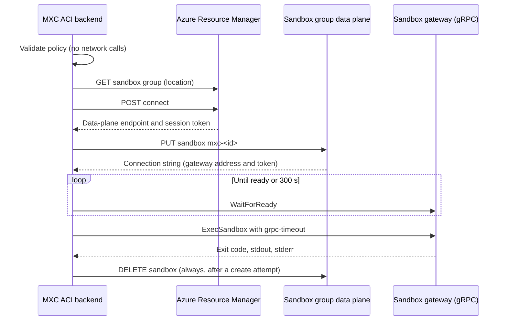

# Feature design: ACI sandbox backend

> **Audience:** MXC developers

- **Status:** Proposed
- **Issue:** Not yet filed.
- **Contributor:** `@ppenna`
- **Implementation PRs:** Not opened.

The backend's behavior, limits, and usage are documented in the
[ACI backend guide](../../../../backends/aci/aci.md). This spec covers the
decisions behind them.

## Problem and scope

- MXC callers can isolate commands only on hosts that support a local
  backend. A caller without Hyper-V, or one that should not spend host
  resources on untrusted work, cannot use a disposable Linux VM.

- Azure Container Instances (ACI) sandboxes are Hyper-V-isolated Linux micro
  VMs that ACI creates on demand in a sandbox group. On the default host type
  they run as Linux containers on Windows hosts (LCOW). The new `aci` backend
  runs a create-and-run request in such a sandbox through MXC's existing
  request and result model.

- Example 1: an agent on a laptop without virtualization support runs
  `pip install -r requirements.txt && pytest` with
  `aci.image: "docker.io/library/python:3.12"` and gets the command's stdout,
  stderr, and exit code. MXC deletes the sandbox.

- Example 2: a service sets `aci.provision: {"cpu": 2, "memoryGb": 4}` and
  `process.timeout: 600000` for a CPU-heavy job. If the job overruns, the
  caller gets a timed-out result, and MXC deletes the sandbox, which stops the
  job.

- Not covered: streaming and PTY execution, container lifecycle operations,
  host filesystem sharing, MXC network or proxy policy, Linux and macOS
  executors, Linux-host, Nanvix, confidential, and stretchable sandboxes,
  snapshots, typed SDK APIs, Azure sovereign clouds, and HTTP proxies.

## Proposed behavior

- The caller provides a development `1.1.0-alpha` request with
  `containment: "aci"` and an `aci` section, authorizes experimental backends,
  and supplies Azure credentials through the Azure CLI or
  `MXC_ACI_ARM_TOKEN`.

- The caller receives captured stdout, stderr, and the exit code, or a
  timed-out outcome. The executor and `v1::dev::run_json` support this;
  executor `--dry-run` checks the request, credentials, and sandbox group
  without creating a sandbox. Other operations are unchanged.

- Defaults: omitted sizing uses ACI's defaults; omitted `process.cwd` and
  `process.env` use the sandbox's defaults; a zero timeout waits until the
  command exits.

- The policy mirrors the NVX MicroVM backend wherever the service can honor
  it. NVX's process limits, working-directory rules, additive environment, and
  lifecycle-option checks apply unchanged through shared validation.
  Filesystem, network, proxy, and UI policy are rejected because MXC cannot
  enforce them in a remote sandbox. Every rejection happens before the first
  Azure call.

## Execution and container lifecycle support

- Run-to-completion execution with captured output: supported. The gateway's
  `ExecSandbox` call is unary and returns the output after the command exits.

- Live stdio streaming and PTY: not supported; requests are rejected before
  setup. The gateway's streaming calls could support them later.

- Container lifecycle operations: not supported; the contract has no ACI
  provision request. Persistent sandboxes need their own ownership and cleanup
  design.

- Create-and-run execution creates and deletes one sandbox per request.

## Backend applicability and availability

| Backend | Planned support | Required host features and how they are checked | What the probe/availability API reports |
| --- | --- | --- | --- |
| ACI | Yes; new experimental backend | Windows executor or SDK built with the `aci` Cargo feature; otherwise `backend_unavailable`. Azure credentials and sandbox group access are checked when a request runs or with `--dry-run`. | Not reported; availability depends on credentials and the sandbox group, not on a host capability. |
| All existing backends | Not applicable; behavior unchanged | Unchanged | Unchanged |

- Backend running without feature support: not applicable, because the
  feature is the backend itself. Requests it cannot honor are rejected before
  any Azure call.

- The backend is registered as experimental, so selecting it requires the
  runtime opt-in.

- Rejected policy returns `policy_validation`; invalid values return
  `malformed_request`. See the guide's
  [supported operations and policy](../../../../backends/aci/aci.md#supported-operations-and-policy).

## Contracts, APIs, and compatibility

- Request fields change: yes, in the development `1.1.0-alpha` contract only.
  - `containment: "aci"` selects the backend.
  - `aci.sandboxGroup` is required: the ARM ID of a
    `Microsoft.ContainerInstance/sandboxGroups` resource, validated by pattern.
  - `aci.image` is required: a registry-qualified reference.
  - `aci.provision.cpu` (whole cores) and `aci.provision.memoryGb` (whole GiB)
    are optional positive integers; omitted values use the service defaults.
  - The `aci` section is required exactly when `containment` is `"aci"`.
  - Published `0.9.0-alpha` and `1.0.0` contracts reject both.

- Public APIs change: no. `v1::dev::run_json` accepts the new backend, and
  the `aci` Cargo feature is additive and off by default.

- Existing request compatibility or runtime behavior changes: no.

## Design and security

- Contract and normalization: closed contract types in
  `mxc_contract/dev/aci.rs` adapt into `CommonRequestIR` and `AciConfig`.

- Engine: the backend registry declares ACI as experimental, and
  `captured_backend()` routes it like MicroVM.

- Backend (`backends/aci/`):
  - `policy` validates and maps the request.
  - `credentials` gets the ARM token.
  - `service` makes the ARM and data-plane REST calls.
  - `gateway` and `proto` call the sandbox gateway over gRPC.
  - `runner` owns the run and its cleanup.

- Shared code: NVX's captured-run results and guest-process validation move
  to `mxc_common::{captured_run, guest_process}` without behavior changes, so
  the two backends do not depend on each other.

- Executor and build: the `wxc` `aci` feature and `build.bat --with-aci`.

- Isolation and trust: yes, these change. The workload runs in the caller's
  Azure subscription inside ACI's Hyper-V boundary, not on the host. MXC
  enforces only request validation. The sandbox group's configuration
  decides network access, which is why MXC rejects network policy rather than
  claim to enforce it.

- Credentials: the ARM token, the data-plane token, and the connection string
  stay in memory. Errors and debug output redact them. All connections use
  HTTPS with the Windows certificate store and connect directly, ignoring
  proxy variables.

- Large refactor or new crate: no. The optional dependencies `ureq`, `h2`,
  `http`, `bytes`, `native-tls`, and `tokio-native-tls` are enabled only by
  the `aci` feature on Windows.

- Alternatives:
  - Running the `azsg` or gateway CLI as a subprocess would add binaries to
    distribute and require parsing their output; it was rejected.
  - A generated `tonic` client would add code generation for three unary
    calls; a small tested codec is enough.

## Resource ownership and failure recovery

- Systems: Azure Resource Manager owns the sandbox group. The ACI data plane
  owns sandbox resources, the gateway runs the command, and the Azure CLI
  issues the ARM token.

- Ownership: the caller owns the sandbox group and its network
  configuration. MXC owns each sandbox from its PUT until ACI accepts the
  DELETE, and ACI completes the deletion asynchronously. MXC creates no host
  state; the Azure CLI child process is bounded by a 120 s timeout.

- Failures, timeouts, and Ctrl-C: after any create attempt, MXC deletes the
  sandbox, including when creation, startup, or the command fails. It renews
  the data-plane session first if it is about to expire. REST calls retry
  throttling, server errors, and transport failures. With
  `--cancel-on-stdin-close`, closing the executor's stdin cancels like Ctrl-C,
  for launchers that cannot send console control events.

- Process exit or loss of connectivity: a killed process deletes nothing.
  The sandbox keeps running in the group and is identifiable by its `mxc-`
  name prefix, its `createdBy: mxc` tag, and the audit `SandboxIdentity`
  event, which MXC records before creating it.

- Cleanup failure: the error reports the original failure and the cleanup
  failure, names the sandbox and group, and asks the caller to delete it. The
  audit `SandboxTornDown` event records `status: failed`.

- The next request is independent: each request uses a new random name and
  shares no state. Leftover sandboxes only consume group capacity.

- Existing containers left partially changed: not applicable; there are no
  lifecycle operations.

## Acceptance criteria and validation plan

| Scenario | Asserted result | Test and CI suite |
| --- | --- | --- |
| Executor run | stdout, stderr, and exit code relayed; audit teardown `ok` | `aci_e2e` live, manual |
| `run_json` run | Separate stdout and stderr, exit code, environment, and working directory | `aci_e2e` live, manual |
| Sizing | `cpu: 2` gives `nproc` 2 | `aci_e2e` live, manual |
| Timeout | `TimedOut` within 100 s and sandbox deleted | `aci_e2e` live, manual |
| Missing working directory | `backend_error` and sandbox deleted | `aci_e2e` live, manual |
| Image rejected by ACI | `malformed_request` with HTTP 400 | `aci_e2e` live, manual |
| Dry run | Success without a sandbox; missing group gives `backend_unavailable` | `aci_e2e` live, manual |
| Ctrl-C during startup and execution | Exit code 130 and audit teardown `ok` | `aci_e2e` live, manual |
| Closing stdin with `--cancel-on-stdin-close` during startup and execution | Exit code 130 and audit teardown `ok` | `aci_e2e` live, manual |
| Opt-in, streaming, PTY, lifecycle, unsupported build | `backend_unavailable`, `unsupported_containment`, or `malformed_request` before any Azure call | `aci_e2e`, "Test ACI request handling without Azure" (Windows PR, x64 and arm64) |
| Policy rejection matrix | Each rejected field fails before any Azure call | `aci_e2e`, same step |
| Runner ordering, cleanup, startup, and error mapping | Deletion follows every create attempt; cleanup failures are reported | `backends/aci` unit tests, "Test ACI backend" |
| Gateway client | Framing, statuses, deadlines, cancellation, and size limits against an in-process HTTP/2 server | `backends/aci` unit tests, same step |
| Contract | Valid and invalid fixtures, version boundaries, and the containment enum | Contract tests in the Windows and Linux "Test" steps |

- CI checks removed: none. NVX tests that moved with the shared code still
  run in the existing steps.

- Not tested in CI: behavior against Azure, which needs the credentials
  described in [Open questions](#open-questions).

## Delivery and documentation

- PRs, in order:
  1. This spec.
  2. Extract NVX's captured-run and process validation helpers into
     `mxc_common`, without behavior changes.
  3. Add the development contract, normalization, and regenerated schema and
     TypeScript.
  4. Add the backend, engine routing, executor feature, build flag, CI steps,
     and documentation.

- Contract publication: ACI stays in the development contract. Publication
  and promotion out of experimental status are separate decisions.

- Documentation: the new [ACI backend guide](../../../../backends/aci/aci.md),
  plus updates to `docs/schema.md`, the development policy guide, the root and
  `mxc-sdk` READMEs, the Rust `dev` API reference, and the CI validation
  runbook.

## Open questions

- Scheduled validation (maintainers and the ACI team): which subscription,
  sandbox group, and federated identity can the validation job use? See
  [ACI validation](../../../build-and-test/ci-validation-infrastructure.md#aci-validation).

- Release builds (maintainers): should release artifacts enable `aci`? They
  do not yet.

- Service behavior (ACI team): MXC's documented limits come from these
  service issues.
  - A command that writes about 60 KB or more to stderr never returns.
  - `ExecSandbox` ignores `timeout_seconds`, and neither a deadline nor
    cancellation stops the command.
  - A sandbox whose image cannot be pulled stays `creating` with no failure
    reported.
  - Commands do not get the image's `ENV` settings, such as its `PATH`.
  - Responses are limited to 4 MiB.

- Preview APIs (ACI team): MXC pins REST API version `2026-06-01-preview` and
  the current gateway contract. What stability and versioning will they have?

## Review checklist

- [ ] The issue has maintainer-applied `feature-accepted`; scope and contributor are agreed.
- [ ] One or two meaningful usage examples, non-goals, defaults, and failure behavior are clear.
- [ ] Every backend is considered, with explicit capability checks and probe/availability behavior.
- [ ] Execution modes and container lifecycle support are explicit; exclusions are explained.
- [ ] Resource ownership, partial failures, failed cleanup, and subsequent container creation are addressed.
- [ ] Security, contract/API compatibility, and any breaking changes are addressed.
- [ ] A separate API proposal is linked when public APIs change.
- [ ] Acceptance criteria and the CI plan cover observable behavior.
- [ ] Delivery and documentation changes are scoped; material questions are resolved.
- [ ] Answers are concise; diagrams explain the design without repeating the text.
- [ ] Maintainers have approved the spec and its status is Accepted before merge.
