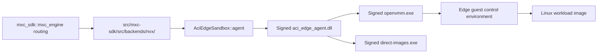
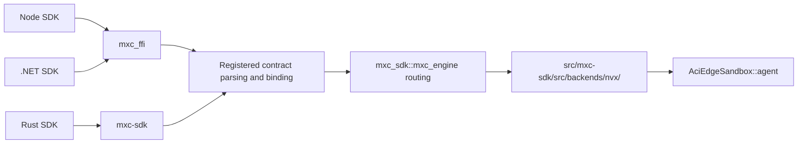
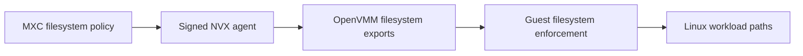

# NVX integration in MXC

**Status:** Integration proposal.

Future tense describes work proposed for the MXC integration.

## 1. Introduction

[NVX][nvx-readme] provides ultra-light microVMs for running
untrusted workloads with hardware-enforced isolation. It is built on OpenVMM,
runs Linux as its guest, and targets cross-platform agentic workloads.

Customers will use NVX through the MXC APIs and will not need to understand
OpenVMM, the guest agent, or image conversion.
The implementation will initially remain experimental or preview while the
integration is validated end to end.

NVX offers hardware-enforced isolation, warm
repeated execution, and direct Rust integration, with rich filesystem and
network controls compared to the existing Nanvix implementation. It will replace
Nanvix as the backend for the `microvm` option. The `microvm` backend will
support Windows only.

## 2. NVX distribution and MXC consumption

### 2.1 NVX crate and runtime files

MXC will pin `aci_edge_sandboxes` to a revision, with default features disabled and `agent-bundled` enabled.

The crate's `build.rs` downloads and verifies `aci-edge-sandboxes.zip` from, as an example, [release `v0.1.0-dev.0430ce79d125`][nvx-release].
It stages the native agent, OpenVMM, guest files, image tool, and supporting metadata.
MXC adds independent checks against its approved file set and hashes.

The bundle includes:

- `bin/aci_edge_agent.dll`
- `bin/openvmm.exe`
- `bin/direct-images.exe`
- `guest/vmlinux`, `guest/initramfs-edge.cpio.gz`, and `guest/nvx-edge-agent`
- manifests, checksums, provenance, licences, and notices

[Appendix D.1](#d1-archive-and-source-validation) describes archive validation
and corresponding-source delivery.

### 2.2 How MXC will consume NVX

The NVX backend module in `mxc-sdk` (`src/mxc-sdk/src/backends/nvx/`) will call
`AciEdgeSandbox::agent(AgentConfig::bundled(...))`.
`mxc_sdk::mxc_engine` owns routing; the signed native agent owns VM execution
and image preparation.

The final executable or SDK package cannot depend on a Cargo dependency's
`OUT_DIR`.
The MXC build module uses
`DEP_ACI_EDGE_SANDBOXES_AGENT_ARTIFACTS_DIR` to stage the complete
`aci-edge-sandboxes` directory beside the executable.
Normal Cargo builds stage the bundle automatically.
Application distribution must include the complete runtime directory.
The npm and NuGet packages will contain the same files.

[Appendix D](#appendix-d-runtime-packaging-and-validation-details) describes
the package validation and source-file requirements.

### 2.3 Key NVX files that MXC will use

| Bundle file | Purpose |
| --- | --- |
| `bin/aci_edge_agent.dll` | Signed native library that owns the sandbox lifecycle |
| `bin/openvmm.exe` | Signed Windows virtual-machine executable |
| `bin/direct-images.exe` | Signed host-side image download and conversion tool |
| `guest/vmlinux` | Linux kernel, protected by the approved checksum |
| `guest/initramfs-edge.cpio.gz` | Guest control environment, protected by the approved checksum |

The selected agent bundle supplies signed Windows binaries.
Linux guest files use checksum verification, not Windows Authenticode signatures.

[Appendix D.3](#d3-release-files-and-native-dll) describes the release files
and existing native DLL.

### 2.4 Developer packaging and usage

The NVX runtime will be distributed with the SDK for each ecosystem.
Developers will not separately install or invoke OpenVMM.

| Ecosystem | Developer dependency |
| --- | --- |
| Rust | `mxc-sdk` with the `microvm` feature |
| Node | `@microsoft/mxc-sdk` and `@microsoft/mxc-nvx-runtime` |
| .NET | `Microsoft.Mxc.Sdk` and `Microsoft.Mxc.Sdk.Nvx.Runtime` |

#### 2.4.1 Rust

```toml
[dependencies]
mxc-sdk = { version = "...", features = ["microvm"] }
```

#### 2.4.2 npm

```bash
npm install @microsoft/mxc-sdk @microsoft/mxc-nvx-runtime
```

The runtime package supplies the NVX files. The base SDK owns
`mxc_ffi.dll`. [Appendix D.4](#d4-sdk-runtime-packaging) describes the package
layout and registration flow.

#### 2.4.3 NuGet

```xml
<PackageReference Include="Microsoft.Mxc.Sdk" Version="..." />
<PackageReference Include="Microsoft.Mxc.Sdk.Nvx.Runtime" Version="..." />
```

For .NET, `Microsoft.Mxc.Sdk` will be the only package that owns
`mxc_ffi.dll`. The runtime package supplies the matching NVX files.
[Appendix D.4](#d4-sdk-runtime-packaging) describes the NuGet copy and
validation requirements.

#### 2.4.4 Common packaging and validation

The developer experience will be the same in all three ecosystems:

1. Developers will add the MXC SDK and its NVX runtime dependency. Rust
   builds use automatic bundle staging.
2. They will select `microvm` in the MXC request.
3. The SDK will locate the packaged NVX runtime for the current platform.
   Node will register the separately installed runtime package directory with
   `mxc_ffi`.
4. MXC will validate the signatures and checksums, then launch OpenVMM through
   the NVX Rust integration.


[Appendix D.6](#d6-package-compatibility-and-runtime-file-validation) defines
version matching, signature checks, and checksum checks.

#### 2.4.5 SDK API exposure

MXC will expose MicroVM through `mxc_sdk::v1::experimental` using the existing request, result, and lifecycle types.
Creation and provision require an image and optionally accept `microvm.provision.memoryMib`.
In Rust, `memory_mib: None` omits the override.

##### Rust availability check

```rust
let backends = mxc_sdk::v1::available_backends();
if !backends
    .iter()
    .any(|backend| backend.backend == "microvm")
{
    return Err("MicroVM is unavailable on this host".into());
}
```

##### Rust `run`

```rust
use mxc_sdk::v1::{
    self,
    ContainerRequest,
    Containment,
    WaitResult,
};

fn main() -> Result<(), Box<dyn std::error::Error>> {
    let request = ContainerRequest {
        containment: Containment::MicroVm {
            image: "python:3.12-alpine".into(),
            memory_mib: Some(256),
        },
        timeout_ms: Some(30_000),
        ..ContainerRequest::new("python -c \"print('hello from NVX')\"")
    };

    let result = v1::experimental::run(request, Default::default())?;
    print!("{}", String::from_utf8_lossy(&result.stdout));
    eprint!("{}", String::from_utf8_lossy(&result.stderr));

    match result.outcome {
        WaitResult::Exited(code) => println!("exit={code}"),
        WaitResult::TimedOut => println!("timed out"),
    }

    Ok(())
}
```

##### Rust `spawn`

Rust `spawn` uses the same `ContainerRequest` and `Containment::MicroVm`
fields as `run`.

##### Rust container lifecycle

```rust
use mxc_sdk::v1::{
    self,
    ExecutionRequest,
    ProvisionRequest,
};

fn main() -> Result<(), Box<dyn std::error::Error>> {
    let provisioned = v1::experimental::container::provision_container(
        ProvisionRequest::microvm("python:3.12-alpine", Some(512)),
        Default::default(),
    )?;
    let id = provisioned.container_id;

    v1::experimental::container::start_container(&id, Default::default())?;
    let result = v1::experimental::container::run_in_container(
        &id,
        ExecutionRequest::new("echo hello"),
        Default::default(),
    )?;
    println!("{}", String::from_utf8_lossy(&result.stdout));
    v1::experimental::container::stop_container(&id, Default::default())?;
    v1::experimental::container::deprovision_container(&id, Default::default())?;
    Ok(())
}
```

[Appendix F.3](#f3-contract-and-sdk-publication) describes contract and SDK
publication.

## 3. Architecture

### 3.1 MXC integration

`mxc_sdk::mxc_engine` will resolve `containment: "microvm"` to the NVX runner
module inside the `mxc-sdk` crate under `src/mxc-sdk/src/backends/nvx/`.
[Appendix E.2](#e2-mxc-integration) describes the runner interfaces, SDK
paths, and NVX calls.
[Appendix A](#appendix-a-nvx-openvmm-and-guest-architecture) describes the
NVX, OpenVMM, and guest architecture.

## 4. Filesystem, lifecycle, and network support

The integration will target the MXC `1.1.0-alpha` development schema.

### 4.1 Schema example

[Appendix F.1](#f1-create-and-run-request-example) contains the create-and-run
request example.

### 4.2 Filesystem

[Appendix F](#appendix-f-schema-and-policy-implementation-details) describes
path mapping, access checks, and Windows path restrictions.

| MXC field | Behavior |
| --- | --- |
| `filesystem.readonlyPaths` | Accept only when the runtime advertises support |
| `filesystem.readwritePaths` | Accept only when the runtime advertises support |
| `filesystem.deniedPaths` | Accept only when the runtime advertises support |

Unsupported mappings must fail before container creation.


### 4.3 Network

[Appendix F](#appendix-f-schema-and-policy-implementation-details) describes
how NVX maps the network policy to OpenVMM.

| MXC Schema field or rule | Works today |
| --- | --- |
| `network.egress.default: allow` | Yes |
| `network.egress.default: deny` | Yes |
| IPv4/CIDR allow and deny rules | Yes |
| TCP and UDP ports and ranges | Yes |
| CIDR `except` entries | Yes |
| `protocol: any` with ports | Yes |
| `network.ingress.default: deny` | Yes |
| `network.ingress.hostLoopback: deny` | Yes |
| IPv6 rules | Yes |
| ICMP-only rules | Yes |
| `network.ingress.default: allow` | No |
| `network.ingress.hostLoopback: allow` | Yes |
| `runtimeConfig.networkProxy` | Yes |

[Appendix F](#appendix-f-schema-and-policy-implementation-details) lists the
network rule limits and rejection behavior.

### 4.4 Lifecycle

The MXC `1.1.0-alpha` contract does not contain state-aware MicroVM provision
types. MXC will add these types before the SDKs publish the NVX lifecycle.

One-shot and state-aware provision use the same MicroVM configuration.
[Appendix F.4](#f4-state-aware-provision-shape) contains the state-aware
request shape.

| MXC phase | How NVX handles it |
| --- | --- |
| `provision` | Resolves the OCI reference to an immutable digest. Selects or creates the converted artifact. Stores that identity with the configuration. Returns an MXC container ID. |
| `start` | Launches OpenVMM and waits for the guest agent |
| `exec` | Runs a workload in the running VM |
| `stop` | Stops the VM while retaining provisioned state |
| `deprovision` | Removes the provisioned state |
| One-shot | MXC will compose provision, start, exec, stop, and deprovision |

MXC will expose container IDs in the following form:

```text
microvm:<32 lowercase hexadecimal characters>
```

MXC will register the `microvm:` prefix in state-aware dispatch so `start`,
`exec`, `stop`, and `deprovision` route back to the NVX runner. The NVX backend
will translate between this public ID and the native
`aci-edge-sandboxes:<32 lowercase hexadecimal characters>` ID.

[Appendix F](#appendix-f-schema-and-policy-implementation-details) describes
ID routing, cleanup behavior, and repeated `exec` calls.

- NVX runs up to 16 workloads at once in one sandbox. An additional `exec`
  fails with `backend_error`.
- `stop` waits for up to 30 seconds before forcing the VM to shut down.
- Cancelling an SDK wait does not kill the workload. Use the execution handle
  to cancel the workload and its descendants.

## 5. UI and other support

| Schema field or capability | Support | Notes |
| --- | --- | --- |
| `ui` | Unsupported | Reject when supplied |
| `process.commandLine` | Supported | Runs a POSIX shell command inside the Linux workload image |
| `process.cwd` | Supported | Must be an absolute guest path without `..` components |
| `process.env` / `inheritDefaultEnv` | Supported with restrictions | Additive entries only, at most 256 entries and 32 KiB total. An explicit environment requires `inheritDefaultEnv=true`. Reject proxy variables. |
| `process.timeout` | Supported | Maximum one hour. An omitted value or `0` means no execution deadline. |
| Separate stdout and stderr | Captured and streaming | Preserve distinct streams and the execution outcome |
| Live stdin | Supported by the native agent | MXC streaming adapters must expose the pipe and explicit EOF ownership |
| PTY | Unsupported | Future work needed; Reject before workload launch |
| Guest memory override | Native capability; development setting | Use optional `microvm.provision.memoryMib` for create-and-run and provision. |
| `fallback` | Unsupported | Reject. NVX does not select another backend. |

[Appendix F](#appendix-f-schema-and-policy-implementation-details) describes
command execution, environment, output, and result behavior.

Open question - The signed agent streams output without a total-output size limit. Capturing all output can therefore consume increasing host memory. Is this an issue?

NVX lifecycle errors align with the existing
[MXC SDK error classifications](../../api-reference/rust/v1/types.md). The NVX runner
will map the additional NVX execution outcomes as described in
[Appendix B](#appendix-b-nvx-execution-outcome-mapping).

## 6. Image support

The caller supplies the workload image through required `microvm.image`.
There is no MXC-selected default image.
The signed native agent already accepts registry references through
`SandboxSpec` and uses bundled `direct-images.exe` to prepare them on the host.
A first use can require host registry connectivity.
Guest network denial does not prevent this host-side preparation.

### 6.1 Standard OCI image and workload

Both create-and-run and provision require the same `microvm.image` field.
For example:

```json
{
  "microvm": {
    "image": "python:3.12-alpine",
    "provision": {
      "memoryMib": 256
    }
  }
}
```

`mcr.microsoft.com/azurelinux/base/core:3.0` is another caller-supplied image,
not an implicit fallback.
[Appendix C](#appendix-c-oci-image-conversion-requirements) describes the
conversion, cache, and security boundaries.

[Appendix F.2](#f2-schema-additions) describes the schema additions.

### 6.2 Verified public registry pulls

Anonymous pulls were verified for:

- Microsoft Container Registry (`mcr.microsoft.com`)
- Docker Hub (`docker.io`)
- GitHub Container Registry (`ghcr.io`)
- Quay (`quay.io`)
- Google Artifact Registry (`us-docker.pkg.dev`)
- Amazon ECR Public (`public.ecr.aws`)

## 7. Windows requirement

The official native-agent bundle supports Windows x64.

| Requirement | Developer action |
| --- | --- |
| Hardware virtualisation | Enable Intel VT-x or AMD-V in firmware |
| Windows Hypervisor Platform | Enable the `HypervisorPlatform` Windows optional feature from an elevated shell and reboot |
| Running Windows hypervisor | Ensure hypervisor launch has not been disabled |
| NVX runtime | Deploy the approved `aci-edge-sandboxes` directory with the development build. Separate SDK runtime packages remain proposed. |

Enable Windows Hypervisor Platform from an elevated PowerShell session:

```powershell
Enable-WindowsOptionalFeature -Online -FeatureName HypervisorPlatform -All
```

[Appendix E.3](#e3-platform-support) describes `platform_support()`,
`unavailableReasons`, and runtime checks.

## 8. Requirements and end-to-end tests

The NVX backend will be complete when the following areas pass through all
three SDKs on Windows x64 with WHP. MXC may also run applicable cases through
`wxc-exec` as an internal end-to-end test path. The relayed `wxc-exec` path is
excluded from state-aware timeout expectations because it cannot represent a
distinct timed-out result. `wxc-exec` is not part of the public NVX SDK API.

| Area | Required coverage |
| --- | --- |
| Integration | `microvm` routes to the NVX runner for one-shot and state-aware execution. Rust, Node, and .NET use this runner. `wxc-exec` is used only for internal E2E tests. |
| Platform support | Add `unavailableReasons` to `mxc_engine::PlatformSupport`. Return it through Rust, Node, and .NET. Include `microvm` only after the NVX runner and `AciEdgeSandbox::probe()` succeed. |
| Lifecycle | Test each lifecycle phase and the exact ID prefix. Test repeated and overlapping exec calls. Test reconnect, invalid transitions, stale IDs, prefix isolation, and one-shot cleanup. |
| Container process lifetime | Use the signed agent's process-lifetime contract, not a direct `OpenVmmConfig` setting in MXC. Verify persistence after the caller exits and reconnection from a later process. Surface host restrictions explicitly. |
| SDKs and FFI | Rust, Node, and .NET produce the same policy and results. Verify `mxc_ffi` handle ownership and cleanup. Node registers the NVX runtime directory before `getPlatformSupport()` or execution. .NET registers both request shapes in `MxcJsonContext` and tests them in `Microsoft.Mxc.Sdk.AotSmokeTest`. |
| Filesystem | Test read-only, read-write, and denied paths. Test files, directories, multiple mappings, and invalid combinations. Test file ownership, ACL inheritance, protected roots, ancestor and drive-root mappings, aliases, reparse points, path limits, and command-line limits. |
| Network | Defaults, allow/deny precedence, CIDRs, exclusions, TCP/UDP ranges, and rejection of unsupported rules |
| Process | Test command, CWD, environment, cancellation, output limits, nonzero exits, and descendant cleanup. Test timeouts through the three in-process SDK paths. Exclude the relayed `wxc-exec` path from timeout tests. |
| PTY | Verify that the initial implementation rejects PTY requests. Add terminal tests when PTY support is available. |
| Packaging | Test Rust, npm, and NuGet installation when those packages exist. Verify that one package owns `mxc_ffi.dll` in each SDK. Test SDK-owned runtime discovery and complete `aci-edge-sandboxes/**` copies. Test invalid RID combinations and missing files. Verify source references. |
| Signing | Validate the Authenticode chain and Microsoft signer. Check all file hashes. Reject runtime directories that an untrusted user can modify. |
| Host | Run tests on Windows x64 with WHP enabled. ARM support remains planned. |
| Image support | Test the required image through both creation paths, generated SDK types, conversion, cache misses, invalid output, and converter security cases. Keep the dated public-pull matrix separate from conversion and guest-execution evidence. |

Negative filesystem and network tests must include a working positive control
so infrastructure failures are not mistaken for policy enforcement.

## 9. Long-term plan

- Converge the NVX MicroVM integration under the broader WSL platform.
- Reuse and align session, image, SDK, and runtime concepts with WSLC.
- Allow MXC to replace its direct NVX integration without changing the
  public SDK API.

## Appendices

- [Appendix A: NVX, OpenVMM, and guest architecture](#appendix-a-nvx-openvmm-and-guest-architecture)
- [Appendix B: NVX execution outcome mapping](#appendix-b-nvx-execution-outcome-mapping)
- [Appendix C: OCI image conversion requirements](#appendix-c-oci-image-conversion-requirements)
- [Appendix D: Runtime packaging and validation details](#appendix-d-runtime-packaging-and-validation-details)
- [Appendix E: NVX runner, probe, and platform-support details](#appendix-e-nvx-runner-probe-and-platform-support-details)
- [Appendix F: Schema and policy implementation details](#appendix-f-schema-and-policy-implementation-details)

## Appendix A: NVX, OpenVMM, and guest architecture

### A.1 Guest architecture

The NVX runner constructs `AgentConfig::bundled` and calls
`AciEdgeSandbox::agent`.
The crate loads `aci_edge_agent.dll`.
That signed library owns the lifecycle, OpenVMM processes, guest sessions, and
image preparation.
MXC does not construct `OpenVmmConfig` or call `AciEdgeSandbox::openvmm()`.

OpenVMM boots the bundle's Linux kernel and control initramfs.
The control environment prepares the workload image and runs the guest agent.

| Guest component | Role |
| --- | --- |
| Control initramfs | Prepares the guest, networking, and filesystem mappings |
| Edge guest agent | Handles workload execution and control messages |
| Workload image | Supplies the shell, executables, and libraries used by commands |



### A.2 NVX Rust interface

The MXC backend uses the following NVX crate operations:

| Operation | NVX Rust API | Input structure | Output structure |
| --- | --- | --- | --- |
| Validate provision | `AciEdgeSandbox::validate_provision_with` | Provision policy and `SandboxSpec`, including the caller's image and optional memory | Validation result |
| Validate execution | `AciEdgeSandbox::validate_exec` | `&ExecRequest { process { commandLine or argv, cwd?, env?, inheritDefaultEnv?, timeout? }, stdin }` | `Result<()>` |
| Check runtime files and hypervisor | `AciEdgeSandbox::probe` | None | `Result<()>` |
| Provision VM | `AciEdgeSandbox::provision_with` | `&ProvisionRequest`, `&SandboxSpec` | `Result<ProvisionResult { sandboxId, metadata? }>` |
| Start VM | `AciEdgeSandbox::start` | `&SandboxId` | `Result<StartResult { metadata? }>` |
| Execute workload | `AciEdgeSandbox::exec` | `&SandboxId`, `&ExecRequest` | `Result<Execution>` with live stdout and stderr pipes, optional stdin pipe, cancellation handle, and wait methods |
| Stop VM | `AciEdgeSandbox::stop` | `&SandboxId` | `Result<StopResult { metadata? }>` |
| Remove provisioned state | `AciEdgeSandbox::deprovision` | `&SandboxId` | Returns `DeprovisionResult`. The ID becomes stale. |
| Wait for execution outcome | `Execution::wait` | Owned `Execution` handle | `Result<ExecOutcome>`: `Exited(code)`, `Signaled(signal)`, `TimedOut`, `Cancelled`, or `Failed(reason)` |
| Wait and collect output | `Execution::wait_with_output` | Owned `Execution` handle | `Result<ExecOutput { outcome, stdout: Vec<u8>, stderr: Vec<u8> }>` |
| Get cancellation handle | `Execution::canceller` | `&Execution` | `Canceller` |
| Cancel execution | `Canceller::cancel` | `&Canceller` | `Result<()>` |

[Appendix E.1](#e1-current-probe-behavior) describes the current `probe()`
result and checks.

MXC maps `microvm.image` and optional `microvm.provision.memoryMib` into
NVX's `SandboxSpec`.

### A.3 Communication boundaries

| Connection | Mechanism | Purpose |
| --- | --- | --- |
| MXC NVX backend to `AciEdgeSandbox` | In-process Rust API calls | Invokes validation, provision, start, exec, stop, and deprovision |
| NVX Rust agent client to `aci_edge_agent.dll` | NVX-owned native ABI | Delegates lifecycle, image, and guest-session ownership to the signed agent |
| Native agent to OpenVMM and image tool | NVX-owned process and control interfaces | Starts the approved runtime and prepares the workload image |
| Runtime to guest agent | NVX-owned guest protocol | Carries readiness, execution, streams, cancellation, and outcomes |


## Appendix B: NVX execution outcome mapping

| NVX outcome | MXC result |
| --- | --- |
| `Exited(code)` | Will return the workload exit code |
| `Signaled(signal)` | Will return `128 + signal` through the existing integer exit result |
| `TimedOut` through an in-process Piped SDK path | Will return the existing MXC timed-out result |
| `TimedOut` through the `wxc-exec` Relayed path | The relay cannot return a distinct timeout. Tests exclude this path. A returned `TimedOut` value produces `backend_error`. |
| `Cancelled` | Live handles return exit code `137`. The captured mapper treats unexpected cancellation as `backend_error`. |
| `Failed(reason)` | Will return `backend_error` with the native failure reason preserved |
| Working-directory setup failure | Reported by the native agent as `Exited(126)` with an `NVX-EDGE-STAGE-ERROR` diagnostic on stderr |
| No outcome available | Will return `backend_error`. It will not invent a workload exit code. |

## Appendix C: OCI image conversion requirements

NVX provides image selection, conversion, and runtime attachment.

| Area | Required definition |
| --- | --- |
| Input identity | Resolve the OCI reference to an immutable digest and record the registry or source |
| Execution-time host fetch | Registry pulls run on the host before VM start and can require host network access |
| Redirects | Define redirect behavior and error reporting in the NVX image tool |
| Credentials | The initial release will not support private-registry credentials. Future credentials must use an approved host provider. Requests, command lines, logs, and telemetry must not contain them. |
| Conversion timing | Pull and convert before VM start. Reuse a compatible cached conversion when available. |
| Converter security ownership | NVX defines and reviews the containment or no-host-extraction design. NVX also defines path rules, resource limits, output limits, cleanup, and security tests. |
| Converted artifact | Produce a versioned NVX artifact with a manifest identifying the source digest, converter version, runtime compatibility, and checksums |
| Guest integration | The edge guest attaches the converted image read-only and keeps writable state in RAM |
| OCI metadata | Define how `ENTRYPOINT`, `CMD`, `ENV`, `WORKDIR`, and `USER` interact with MXC process settings |
| Writable state | Define the writable layer or scratch lifetime and whether it is discarded on stop or deprovision |
| Cache identity | NVX caches references by their text within a state root. Use digest references when content identity is required. |
| Failures | Return registry, conversion, compatibility, and attachment failures as `MxcError` values that name the failed operation and reason |

### C.1 Registry and cache behavior

See [Section 6.2](#62-verified-public-registry-pulls) for the previously verified
public registry pulls.

The NVX native host manages converted images under its state root:

1. Use the image from the local cache when it is already available.
2. On a cache miss, invoke the signed NVX image tool to pull
   the image and resolve its immutable digest.
3. Convert and cache the NVX-compatible artifact.

NVX caches a reference by its text and does not automatically refresh a tag.
A later provision using that state root can therefore reuse earlier content.

`microvm.image` may reference OCI registries such as Docker Hub. The NVX image
tool will define how short image references are resolved.
The NVX image tool handles registry access, image download, and conversion.
Guest egress restrictions do not bound the host's registry downloads.
The native reference-pull timeout defaults to 30 minutes.

### C.2 Converter security

The NVX team will own the converter's security design for processing
untrusted OCI manifests and layers. The design must include a threat model and
a containment or no-host-extraction method. It must also define path checks,
resource limits, cache boundaries, cleanup, and security tests. Signing
authenticates the converter. It does not contain parser or archive-processing
vulnerabilities. MXC will not enable arbitrary OCI image input until that
design completes security review.

`microvm.image` accepts an OCI image reference, not an arbitrary host image path.
NVX supports an explicitly configured host credentials file.
MXC does not expose that setting in the image input.

## Appendix D: Runtime packaging and validation details

### D.1 Archive and source validation

The crate downloads and verifies the signed agent bundle.
MXC pins the complete approved file set and each file's SHA-256.
The selected ZIP has SHA-256
`98e3d6011b0664fad6fa783768370a34209639463f5ab812b7776840660ac24e`.
The image download and conversion tool is already part of this bundle.

MXC will verify the source and staged copies against the approved file set and
hashes, rejecting links, reparse points, and unsafe copy paths.

The selected bundle contains `SOURCE-MANIFEST.json`, provenance, licences,
and third-party notices.
Source references must match the selected edge runtime and kernel.
MXC consumes NVX source-delivery metadata rather than generating upstream
source archives.

### D.2 Package source files

Before packaging the NVX runtime, MXC will validate `SOURCE-MANIFEST.json`.
MXC will check the references to the matching Linux kernel source.
MXC will also check the references to the selected control-initramfs source.
MXC will copy the source manifest into the npm and NuGet runtime packages.
It will also copy the applicable guest metadata, licences, and notices.
MXC will not generate upstream source archives.
Packaging will fail when required metadata, source references, or
hashes are missing or do not match the runtime version.

### D.3 Release files and native DLL

The release also includes the supporting checksum, manifest, provenance,
licence, and guest metadata files.
These artifacts contribute to the staged runtime and SDK package footprint
rather than the published Rust crate archive size.

The signed `aci_edge_agent.dll` already exists.
The NVX crate owns its ABI, handle ownership, and compatibility checks.
MXC uses the crate's agent client rather than binding that DLL independently.

### D.4 SDK runtime packaging

Stage the complete `aci-edge-sandboxes` tree through the MXC
build module.
Use `DEP_ACI_EDGE_SANDBOXES_AGENT_ARTIFACTS_DIR`, not the standalone bundle
metadata variable.
Cargo supplies that metadata to the immediate dependent's build script.
It does not propagate the variable into an application's build script.

`@microsoft/mxc-sdk` will remain the only npm package that owns and loads
`mxc_ffi.dll`. The Node SDK will resolve the runtime package's absolute
platform directory before platform checks or execution. The runtime package
will preserve the `aci-edge-sandboxes` directory and its required files.

For .NET, `Microsoft.Mxc.Sdk` will be the only package that owns
`mxc_ffi.dll`. Its Windows native library will include the MicroVM integration
but will report `microvm` as unavailable when the NVX assets are absent.
`Microsoft.Mxc.Sdk.Nvx.Runtime` will contain only the RID-specific `aci-edge-sandboxes`
directory and will declare an exact-version dependency on
`Microsoft.Mxc.Sdk`.

NuGet's default RID-native asset handling flattens files beneath
`runtimes/{rid}/native`. The runtime package will instead store the assets
under `runtimes/{rid}/aci-edge-sandboxes/**`. It will include
`buildTransitive/Microsoft.Mxc.Sdk.Nvx.Runtime.targets`. That target will copy
the selected RID's complete `aci-edge-sandboxes` tree into build and publish outputs while
preserving `%(RecursiveDir)`.

The Rust code linked into `mxc_ffi.dll` will resolve the packaged bundle
relative to the loaded DLL and configure NVX with that directory explicitly.
The copy target will reject unsupported RID and architecture combinations
rather than produce a partial runtime.

The .NET one-shot `Microvm` containment type and
`MicrovmProvisionRequest` will each be registered as `[JsonSerializable]`
roots in `MxcJsonContext`. Their serialization and deserialization will use
the existing `MxcJson` helpers without reflection fallback.
`Microsoft.Mxc.Sdk.AotSmokeTest` will test representative one-shot and
state-aware MicroVM requests through that production JSON path.

### D.5 Node runtime-directory registration

Registration will apply to the current process. It will accept only registered
backend names and absolute canonical paths. A repeated call with the same
backend and path will succeed. A call with a different path will fail. The
registration only supplies the directory. `mxc_engine` will validate the
package version, architecture, manifest, and checksums. Without the runtime
package, Node will not register an NVX runtime directory.
`getPlatformSupport()` will omit `microvm`.

The Node SDK must resolve the runtime package before discovery or execution.
Its existing native boundary must carry that location into the Rust adapter.
The adapter can use NVX's explicit bundle-directory configuration.

NVX's default bundle discovery also accepts
`ACI_EDGE_SANDBOXES_AGENT_ARTIFACTS_DIR`.
When set, that directory must hold a valid bundle; discovery does not fall back.
Otherwise, discovery checks beside the executable and its parent directory.
Compiled release pins still govern the bundle contents regardless of its path.

### D.6 Package compatibility and runtime-file validation

The MXC SDK, `mxc_ffi.dll`, and NVX runtime package versions must match.
Before launch, MXC will verify the required files, Windows architecture,
signatures, checksums, and runtime manifest compatibility. A missing or
incompatible runtime will return `backend_unavailable` and identify the
required runtime package or version.

A checksum manifest beside runtime files is not an independent
trust source.
Use the approved release identity and the pins compiled into the consumer.
The validation requirements are:

1. Check the Windows Authenticode chain and expected signer for the native
   agent, OpenVMM, and image tool.
2. Check all runtime files against the approved hashes.
3. Reject missing, altered, incompatible, or untrusted runtime files.

## Appendix E: NVX runner, probe, and platform-support details

### E.1 Current `probe()` behavior

The NVX crate's `probe()` returns success or an error, not a structured
capability report.
The agent client separately exposes runtime capabilities.
MXC checks requested features against those capabilities before provision or
execution.

### E.2 MXC integration

`mxc_sdk::mxc_engine` keeps `containment: "microvm"` and resolves it to the
internal NVX backend module in `mxc-sdk` (`src/mxc-sdk/src/backends/nvx/`).

The NVX runner will follow the existing MXC backend interfaces:

- `ScriptRunner` for run-to-completion
- `SandboxBackend` for streaming `spawn`
- `StatefulSandboxBackend` for provision, start, exec, stop, and deprovision

MicroVM participates in Windows backend discovery.
The detector attempts private-state admission and bundled-client creation.
It does not start a VM.

| SDK | Required changes |
| --- | --- |
| Rust SDK | Explicit experimental V1 entry points and development MicroVM provision types |
| .NET SDK | Explicit experimental V1 entry points, development `1.1.0-alpha` request writers through `mxc_ffi`, and matching runtime packaging |
| Node SDK | Explicit experimental V1 entry points, development `1.1.0-alpha` request writers, runtime packaging, and directory registration through `mxc_ffi` |

Node and .NET will continue to use the existing `mxc_ffi` boundary. NVX will
be linked on the Rust side. No separate NVX FFI library will be required.
NVX will not add support
commitments for legacy Node executor paths or introduce a new NVX CLI or
executor. `wxc-exec` may be built with NVX support only for internal
end-to-end tests over the same `mxc_engine` runner.

#### E.2.1 MXC request and NVX call flow

The SDKs expose typed MXC requests. Node and .NET serialize those requests and
cross the existing `mxc_ffi` boundary. Rust passes typed requests through
`mxc-sdk`.
The engine routes execution to the backend.



The NVX runner converts the MXC MicroVM, filesystem, network, and process
fields into the operation-specific NVX request types. It then calls
`AciEdgeSandbox` as follows:

| MXC operation | Input passed to the NVX runner | `AciEdgeSandbox` calls |
| --- | --- | --- |
| Discovery | Private state root and discoverable approved bundle | Constructs the bundled agent client. Does not boot a VM. |
| Captured or streaming create-and-run | Required caller image, optional memory, supported provision policy, and process request | Validates, calls `provision_with`, `start`, and `exec`, then stops and deprovisions during cleanup |
| Provision | Required caller image, optional memory, filesystem, network, and proxy policy | `validate_provision_with` and `provision_with`, according to the requested operation |
| Start | Opaque MXC ID translated to the native NVX ID | `start` |
| Execution | Translated NVX ID and process request | Validates and calls `exec`. Retains pipes, waiter, and cancellation ownership. |
| Execution cancellation | `Execution` handle | `Execution::canceller` → `Canceller::cancel` |
| Stop | Translated NVX ID | `stop` |
| Deprovision | Translated NVX ID | `deprovision` |

The NVX runner maps lifecycle results, execution outcomes, and errors back to
the existing MXC SDK result and error types.
[Appendix B](#appendix-b-nvx-execution-outcome-mapping) defines the
execution-outcome mapping.

### E.3 Platform support

Developers should check platform support before launch using Rust
`platform_support()`, Node `getPlatformSupport()`, or .NET
`MxcPlatform.GetPlatformSupport()`. Node and .NET call
`mxc_platform_support_json()` in `mxc_ffi`, which returns
`mxc_engine::platform_support()`. No separate public NVX probe API will be
added.

`PlatformSupport.availableMethods` would include `microvm` only when the NVX
runner's runtime checks and `AciEdgeSandbox::probe()` succeed. When they fail,
`PlatformSupport.unavailableReasons["microvm"]` will explain whether the
developer must install the runtime package, enable WHP, or repair runtime
files.

`mxc_engine::PlatformSupport` will add an `unavailableReasons` map from backend
wire name to a specific failure reason. The existing platform-wide `reason` will
remain reserved for a host on which MXC itself is unsupported.

| SDK | Backend-specific unavailable-reason field |
| --- | --- |
| Rust | `PlatformSupport::unavailable_reasons` |
| Node | `PlatformSupport.unavailableReasons` |
| .NET | `PlatformSupport.UnavailableReasons`, keyed by `ContainmentBackend` |

For example, ProcessContainer can work when the NVX runtime package is
missing. The host remains supported. `availableMethods` omits `microvm`.
`unavailableReasons` explains how to install the NVX runtime.

The NVX runner will repeat the same runtime checks before launch. A cached
`PlatformSupport` result will not bypass them.

Missing WHP, disabled hardware virtualisation, absent runtime files,
incompatible guest/runtime versions, and unsupported architectures will return
`backend_unavailable` with remediation. OpenVMM startup failures should
identify the associated log path.

## Appendix F: Schema and policy implementation details

### F.1 Create-and-run request example

```json
{
  "version": "1.1.0-alpha",
  "containment": "microvm",
  "microvm": {
    "image": "python:3.12-alpine",
    "provision": {
      "memoryMib": 256
    }
  },
  "process": {
    "commandLine": "python -c \"print('hello from NVX')\"",
    "cwd": "/",
    "timeout": 30000
  }
}
```

MicroVM execution also requires experimental authorization.
For the internal executor path, supply `--experimental`.
In Rust, use the explicit `v1::experimental` entry points.
Selecting the development JSON version alone does not grant authorization.

### F.2 Schema additions

Extend the development `1.1.0-alpha` contract for both MicroVM creation paths.
Require `microvm.image` in create-and-run and provision requests.

| Request type | Schema addition |
| --- | --- |
| Create-and-run execution | Require `microvm.image`; accept optional `microvm.provision.memoryMib` |
| Container provision | Require `microvm.image`; accept optional `microvm.provision.memoryMib` |
| Start, exec, stop, and deprovision | Use the container ID created during provision. Do not accept image or provision-time policy changes. |

The development MicroVM request types reject unknown fields.
Missing, empty, whitespace-containing, or control-character image references
must fail before backend setup.
Memory values must also pass backend semantic and capability validation.

Regenerate the registered development schema and generated TypeScript types.
Add the experimental Rust authoring path.
Register the MicroVM provision request root with the development contract
descriptor and its fixture corpus.
[Appendix F.3](#f3-contract-and-sdk-publication) describes publication.
[Appendix F.4](#f4-state-aware-provision-shape) contains the state-aware
request shape.

### F.3 Contract and SDK publication

Development MicroVM provision and experimental Rust APIs do not modify
released schemas or advance `sdkMajorTargets`.
The ordinary V1 methods retain their stable contract.
The explicit experimental Rust methods use the development contract and
authorize experimental backend selection.
Typed Node and .NET MicroVM support will likewise require explicit experimental
V1 entry points and development `1.1.0-alpha` request writers before promotion
to a stable contract.
Experimental authorization is not a request JSON field.

Contract publication and host availability remain separate. A published
MicroVM backend can still return `backend_unavailable` when the host lacks the
NVX runtime, WHP, or another required capability.

### F.4 State-aware provision shape

The following complete development request provisions a container.
It does not start a workload.
Optional filesystem, network, and runtime proxy policy belongs on this
provision request.

```json
{
  "version": "1.1.0-alpha",
  "phase": "provision",
  "containment": "microvm",
  "microvm": {
    "image": "python:3.12-alpine",
    "provision": {
      "memoryMib": 512
    }
  }
}
```

Omit the `process` section during provision.
The caller selects the image during provision.
A later `exec` request supplies process configuration.
Provision settings cannot change during execution.

### F.5 Filesystem implementation

Pass validated host mappings to the signed NVX agent.
Require its matching read-only, read-write, and denied-path capabilities.
NVX owns the export topology and guest mounts.



Read-write mappings are live. A guest write changes the mapped host file
immediately. OpenVMM hides denied entries in the exported host tree.

Filesystem access has the following enforcement responsibilities:

| Access control | Enforcer |
| --- | --- |
| Which host paths are exposed or hidden | NVX and OpenVMM |
| Whether an exposed path is read-only or read-write | The NVX guest control agent and OpenVMM |
| Whether the OpenVMM process may access a host file | Windows and NTFS, using OpenVMM's Windows process identity |

If a path is not mapped, NVX and OpenVMM prevent access to it. They also
prevent access to an explicitly denied path. This restriction applies even if
the OpenVMM process can access the path. Windows rejects access when the NTFS
ACL denies access to the OpenVMM process. MXC validates the requested
mappings and starts OpenVMM with the intended Windows identity. MXC does not
check each file operation.

Commands use Linux guest paths.
For example, `C:\nvx-work\input` maps to `/mnt/c/nvx-work/input`.
The native-agent README describes one common export with per-path guest mounts.
Its mount arguments must fit the guest's 1024-byte kernel command line.

MXC will reject mappings at or below protected Windows host roots, and
mappings that contain a protected root. These roots include Windows, Program
Files, Program Files (x86), and ProgramData. A drive-root mapping such as
`C:\` is rejected because it contains protected roots.
Use canonical paths and Windows Known Folder resolution.
Case differences, short names, junctions, and reparse points must not bypass
the rule.
Reject both read-only and read-write mappings before OpenVMM starts.
Identify the protected root in the error.

### F.6 Network implementation

Preserve directional policy through the MXC adapter.
Check the selected agent's capabilities before provision.
The signed runtime owns conversion into native network enforcement.


Unsupported network forms are rejected before the VM starts.

| Policy requirement | MXC responsibility |
| --- | --- |
| Deny precedence | Preserve MXC's rule that a matching deny overrides an allow |
| CIDRs, exclusions, protocols, and ranges | Preserve each field. Reject unsupported semantics rather than discarding them. |
| Rule and range limits | Validated by the selected native runtime |
| Omitted network | Preserve absence. Do not silently treat it as an explicit caller policy. |
| Provision-time proxy | Require the advertised proxy capability. Reject execution-time changes. |
| Host image download | Report separately from guest network enforcement |

### F.7 Lifecycle routing and behavior

| Component | Required prefix work |
| --- | --- |
| `mxc_engine` | Routes the MXC `microvm:` prefix to the NVX backend |
| Rust SDK | Preserves the opaque MXC ID through `ContainerId` |
| NVX backend | Translates the MXC ID to and from the native NVX ID |
| Node SDK | Preserve the same public ID and add typed lifecycle routing |
| .NET SDK | Preserve the same public ID and add typed lifecycle routing |

| Action | Workload effect | VM or state effect |
| --- | --- | --- |
| One-shot completion | Returns the workload outcome | MXC stops and deprovisions the VM |
| One-shot failure during provision, start, or exec | The workload may not start or will be terminated | MXC performs bounded stop and deprovision cleanup while preserving the original error |
| `process.timeout` | NVX terminates the workload and its descendants | A state-aware VM remains running. MXC cleans up a one-shot VM. |
| Cancel or kill an execution handle | Cancels the current workload and its descendants | Does not deprovision a state-aware VM |
| Execution caller exits or loses its control session | Must follow the signed agent's disconnect contract | Test workload cleanup and later reconnection separately |
| `stop` during an exec | Must follow the signed agent's stop contract | Test the workload outcome and resulting container state |
| `deprovision` | Requires the VM to be stopped | Removes the provisioned state |

The same running VM can serve repeated `exec` calls.
The signed agent supports concurrent execution within its advertised limits.
Guest-memory state does not survive `stop`.
Changes to mapped host files do survive.

### F.8 Process behavior

| Process behaviour | Developer-visible result |
| --- | --- |
| Command execution | The OCI workload image must provide the required shell or executable. The control initramfs does not run workload commands. |
| Environment | Use workload defaults. Explicit environment entries are additive and require `inheritDefaultEnv=true`. Replacement and proxy variables are rejected. |
| Output limit | The native agent has no total-output size limit |
| Nonzero exit | Returned as a workload result, not an SDK or FFI failure |
| Invalid request or unavailable backend | Returned as an MXC error rather than a workload exit code |

## References and open decisions

### Awaited support

- Publishable NVX dependencies for Rust SDK distribution
- Converter security review and adversarial test evidence
- Windows ARM runtime and SDK package availability
- Future PTY support

### References

- [NVX README][nvx-readme]
- [NVX Rust API overview][nvx-rust]
- [NVX setup guide][nvx-setup]
- [Selected NVX release][nvx-release]
- [MXC schema](../../schema.md)
- [MXC architecture](../architecture/repository-architecture.md)
- [MXC versioning](../architecture/versioning.md)
- [MXC SDK error classifications](../../api-reference/rust/v1/types.md)

[nvx-readme]: https://github.com/microsoft/nvx
[nvx-rust]: https://github.com/microsoft/nvx/blob/0430ce79d125203c20f0aa69243480513a774296/aci_edge_sandboxes/README.md
[nvx-setup]: https://github.com/microsoft/nvx/blob/0430ce79d125203c20f0aa69243480513a774296/doc/setup.md
[nvx-release]: https://github.com/microsoft/nvx/releases/tag/v0.1.0-dev.0430ce79d125
